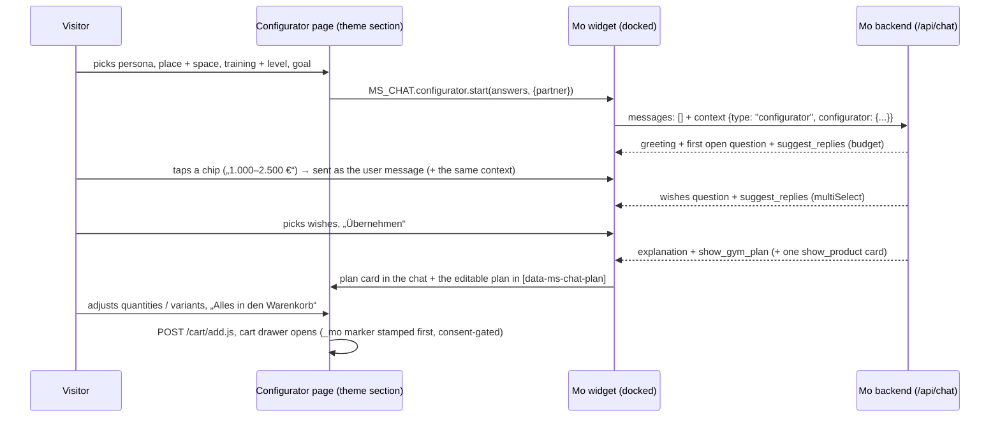

# Home-Gym-Konfigurator — Mo leads the home-gym consultation

The landing page of the Men's Health / Women's Health cooperation: the visitor picks a few basic
answers on the left („Ich bin … / ich will …“), hands them to Mo, and Mo — docked on the right of the
same page — asks for the rest (budget, wishes), builds a home-gym plan from a curated assortment and
puts it into the cart with one click. This document owns the feature; the wire shapes are in
[`frontend/API_CONTRACT.md`](./frontend/API_CONTRACT.md) §2 (`context.type: "configurator"`, the tools
`suggest_replies` / `show_gym_plan`) and §5 (KPI events). Live status: [`ROLLOUT_TODO.md`](./ROLLOUT_TODO.md).

## 1. The flow

The guide follows the order the team defined (Lucas): **1 Personas → 2 Trainingsort & Platz →
3 Trainingsart & Niveau → 4 Trainingsziel** on the page, **5 Budget → 6 Individuelle Wünsche** (assembly,
delivery date, noise, floor protection, no drilling, showroom) asked by Mo with answer chips, at most
1–2 detail questions more (ceiling height, frequency, equipment already owned), never more than four
questions before the first plan. „Zeig mir einfach was“ gets the plan right away.

## 2. Marking the products Mo works with („Konfigurator-Sortiment“)

**Answer to „Tag, Kollektion, wtfe?“: a Shopify product tag.** Every product tagged
`home-gym-konfigurator` (case-insensitive; the tag is configurable in Konfigurator → „Shopify-Tag des
Sortiments“) is in the curated assortment. Why a tag and not a collection: tags are already part of
Mo's catalog sync (`Product.tags`) and of the product search; a collection would need a new field in
the catalog query. A smart collection „Home Gym Konfigurator“ with the rule „Tag ist gleich
home-gym-konfigurator“ can still be created in Shopify for the storefront — Mo only reads the tag.

- **Tagging:** Shopify admin → Produkte → (select several) → „Tags hinzufügen“ → `home-gym-konfigurator`.
  The catalog sync picks it up (nightly, or immediately through the product webhook).
- **Without tagging:** Konfigurator → „Zusätzliche Produkte“ adds products by hand (search picker,
  up to 60) — useful for a test before the shop is tagged.
- **Focus:** „Sortiment bevorzugen“ (default) — Mo plans primarily with the assortment but may add a
  product from the rest of the shop when the visitor asks for it or nothing fits („auch einen
  Gymnastikball, wenn der gewünscht ist“); „Nur Sortiment“ — only assortment products unless the
  visitor explicitly asks for a specific other product.
- **What Mo sees:** the assortment as a compact list in the configurator section of the prompt (handle,
  name, category, price or price range, footprint, sold out, short description, up to three accessory
  handles from „Ergänzende Produkte“) — at most 60 lines, the rest through `search_products`; plus a
  retrieval bonus for assortment products (`retrieval.ts` `boostIds`, +0.08 on the score), so the
  detailed product block of each turn prefers them. Sold-out products are never put into a plan.
- An empty assortment is not an error: Mo then plans from the whole shop.

Good candidates: base units (wall cable stations, fold-back/half/power racks, multi-gyms, Multipressen),
benches, adjustable dumbbells and plate sets, floor protection, the cardio machines for small rooms,
and the accessories of the base units.

## 3. Triggers: what the page sends (answer to „welche Auslöser …?“)

The page sends ids from one vocabulary (`src/lib/configurator-core.mjs` → `CONFIGURATOR_FIELDS`; the
theme's `assets/ms-home-gym-configurator.js` uses the same ids):

| Field | Ids (German label) |
| --- | --- |
| `persona` („Ich bin“) | `busy` Berufstätig & wenig Zeit · `ambitious` Sportlich ambitioniert · `health` Gesundheitsbewusst · `family` Zu zweit / als Familie · `best_ager` Aktiv mit 50+ |
| `location` | `house` Haus / Keller · `apartment` Wohnung (Mietobjekt) · `garage` Garage / Outdoor |
| `space` | `xs` bis 6 m² · `s` 6–10 m² · `m` 10–20 m² · `l` über 20 m² |
| `training` (several) | `free_weights` · `machines` · `cardio` · `functional` |
| `level` | `rookie` · `intermediate` · `pro` |
| `goal` („Ich will“) | `muscle` · `fitness` · `health` · `endurance` · `athletic` |
| `budget` (Mo asks) | `b1` ≤ 1.000 € · `b2` 1.000–2.500 € · `b3` 2.500–5.000 € · `b4` 5.000–10.000 € · `b5` > 10.000 € |
| `wishes` (Mo asks) | `assembly` · `fast_delivery` · `quiet` · `no_drilling` · `foldable` · `floor_protection` · `showroom` |

Required on the page: persona, location, space, level, goal (training is optional). Each answer carries
a consulting cue for Mo where it matters (e.g. `apartment` → quiet, impact/floor protection, drilling
only with the landlord's consent; `xs` → wall stations, fold-back racks, adjustable dumbbells).

**Promotional links** can preselect answers — exactly Alex's idea `?location=house&target=01&skills=rookie&space=01`:

- `?persona=busy&location=apartment&space=xs&training=free_weights,cardio&level=rookie&goal=muscle`
- aliases: `target` / `ziel` → `goal`, `skills` / `niveau` → `level`, `ort` → `location`, `platz` → `space`
- a value may be an option's position: `target=01` = the first goal (`muscle`)
- `?partner=mh` / `?partner=wh`, or a `utm_source` / `utm_campaign` containing „menshealth“ /
  „womenshealth“, marks the partner (seal order on the page, „Herkunft“ in the KPIs); otherwise the
  section setting „Partner dieser Landingpage“.

Prefilled answers are only preselected — the visitor still confirms with „Weiter – Mo berät mich“.

## 4. What Mo does with it

- **Prompt:** `renderConfiguratorSection` (configurator-core.mjs) goes into the system prompt right
  after the opening sentence on every turn of the thread: the answers („schon beantwortet — NICHT
  erneut abfragen“, open fields marked), the consulting cues, the guide, the assortment with the focus
  rule, the team's notes („Hinweise für Mo“) and the plan as it stands on the page. Without it the
  prompt is byte-identical (golden test).
- **Profile:** the answers fill the profile fields the conversation has not set (segment private,
  housing, noise, space as the upper end of the range, level, focus, budget) — the retrieval's space
  and budget gates work from the greeting on; Mo's own `update_customer_profile` always wins.
- **Greeting:** a fresh open gets its own trigger turn and a retrieval query built from the answers.
- **Tools:** `suggest_replies` (2–6 chips; `topic` budget/wishes/frequency/space/equipment/other) and
  `show_gym_plan` (title, summary, 1–12 items with role base/accessory/weights/cardio/flooring/extra,
  quantity, note, ≤ 3 tips). Both are built always and withheld via `activeTools` outside a
  configurator thread, after the tools-tier cache marker — every other conversation's tool list and
  cached prefix are unchanged. The plan tool answers the model with unknown / sold-out ids so it can
  correct itself in the same turn.
- **Cart:** the whole plan goes into the shop cart through the plan's button (`/cart/add.js`);
  `add_to_cart` (direct checkout) only when the visitor wants a single product right away.
- **Switch:** Konfigurator → „Geführte Beratung“ (admin setting, default on). Off: the page still works,
  Mo just chats normally (no answers, chips or plan). Settings are cached per instance for 60 s.

## 5. Admin screen „Konfigurator“

`/admin?tab=konfigurator` (group Arbeit, no digit shortcut — all ten are taken), details in
[`ADMIN_DASHBOARD.md`](./ADMIN_DASHBOARD.md) §3.11:

- **Wirkung** (`?kpiRange=7d|30d|90d`): page views (consent only), handovers, plans, cart value,
  orders + revenue; the funnel „Vom ersten Klick zur Bestellung“; how visitors answered (one card per
  field), the partner split, the products in Mo's plans, chip topics, the 12 latest configurator
  consultations with a link to the transcript in Gespräche.
- **Mo im Konfigurator:** on/off, assortment focus, Shopify tag, extra products, „Hinweise für Mo“
  (≤ 1.500 characters, e.g. a running promotion or delivery times).
- **Sortiment:** the resolved assortment with price, stock and why it is in (Tag / Liste); warnings for
  unknown extra handles and a mostly sold-out assortment.

Storage: `admin_settings` key `configurator` (migration 0078 — **no new migration**). Route:
`POST /api/admin/konfigurator/settings` (`guardAdminPost`, audit `settings.configurator`).

## 6. KPIs and attribution

Events (names and data: API_CONTRACT §5): widget `configurator_viewed` (only with Shopify analytics
consent), `configurator_started`, `configurator_handover`, `configurator_answers_changed`,
`configurator_chip_clicked`, `configurator_plan_edited`, `configurator_cart_added`; server-only
`configurator_chat_started`, `configurator_plan_shown` (in `SERVER_ONLY_EVENTS`). Ids, enums, counts
and booleans only — never a name, text or e-mail.

- Every funnel stage counts **distinct sessions on its own**: the handover starts a fresh thread
  (anonymous visitors get a new session id like „Neuen Chat starten“), so the stages before and after
  the handover can sit on different session ids. Within the chat (chat → plan → cart → order) the
  session is the same.
- **Orders:** realised `mo_orders` (PAID / PARTIALLY_REFUNDED) of a configurator chat session, processed
  after its first `configurator_chat_started` and before the end of the period. They exist only with
  the `_mo` marker, i.e. with analytics consent ([`ORDER_ATTRIBUTION.md`](./ORDER_ATTRIBUTION.md)); the
  plan's products enter the conversation's discussed products (`recommended-products.mjs`), so the
  overlap tier works, and `show_gym_plan` anchors the attribution window like `show_product`.
- `configurator_cart_added` matches `%cart%`, so it also counts as an add-to-cart click on the KPI
  screen.

## 7. Storefront (theme repo `ms_shopify_clone`)

| File | What |
| --- | --- |
| `sections/ms-home-gym-configurator.liquid` | the landing page: hero with the partner seals, configurator, Mo dock, plan host, „So funktioniert's“, cooperation block; all texts and the seals are section settings |
| `assets/ms-home-gym-configurator.js` / `.css` | page logic (answer cards, prefill, partner, handover, edit, stepper, KPI) and styles |
| `templates/page.home-gym-mo.json` | the page template (assign it to a page, or open any page with `?view=home-gym-mo`) |
| `assets/ms-chat-widget.js` / `.css` | docked mode (`[data-ms-chat-dock]`), `window.MS_CHAT.configurator` (`start`, `update`, `restart`, `track`, `state`), the `ms-chat:configurator` events, chips, plan card, plan host, cart add |

The existing static guide (`templates/page.home-gym-konfigurator.json`, blocks `ai_gen_block_296597c` /
`fc74bf0`) is left untouched. The widget must render on the page (theme setting „AI Advisor“ on, the
template not in „ausgeschlossene Vorlagen“). Seals: upload the PNGs of Anna in the theme editor (section
→ „Siegel Men's Health“ / „Siegel Women's Health“); the cooperation text is a section setting with a
draft to be replaced by the partner material.

Screenshots (local harness: the real section and widget, Mo's dialogue mocked, placeholder seals):
[`screenshots/konfigurator/`](./screenshots/konfigurator/) — storefront 1440 / 1024 / 390 px, admin
1440 / 1024 px in light and dark.

## 8. Limits

- The plan is rendered from Mo's tool input; prices and stock come from `/api/products` (catalog sync,
  daily + webhooks) — the cart itself is the shop's truth (a refused line is named, the rest lands).
- Budget and wishes are learned in the conversation (chips are text); only `configurator_chip_clicked`
  records the topic. The answer distribution covers the page's answers.
- Page views need analytics consent; without it the funnel starts at „Konfigurator begonnen“.
