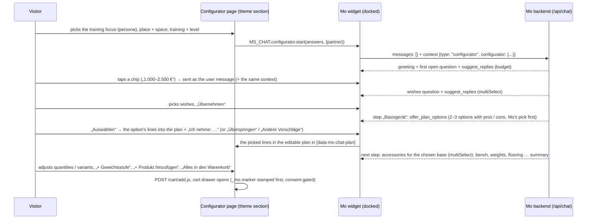

# Home-Gym-Konfigurator — Mo leads the home-gym consultation

The landing page of the Men's Health / Women's Health cooperation: the visitor picks a few basic
answers on the left (the training focus — one of Mo's personas —, place and space, training and
level), hands them to Mo, and Mo — docked on the right of the same page — asks for the rest (budget,
wishes), then goes through the product types one by one — base unit, accessories for it, bench,
weights, flooring — with two to three options each, from which the visitor picks into the plan on the
page; the visitor can extend the plan with own products from the whole shop and weight steps, and puts
it into the cart with one click. This document owns the feature; the wire shapes are in
[`frontend/API_CONTRACT.md`](./frontend/API_CONTRACT.md) §2 (`context.type: "configurator"`, the tools
`suggest_replies` / `offer_plan_options` / `show_gym_plan`), §3b (assortment and search) and §5 (KPI events). Live status: [`ROLLOUT_TODO.md`](./ROLLOUT_TODO.md).

## 1. The flow

The guide follows the order the team defined (Lucas), revised with Anna's feedback of 22.10.2026:
**1 Typ / Trainingsfokus → 2 Trainingsort & Platz → 3 Trainingsart & Niveau** on the page (the former
fourth card „Ich will …“ is gone — the training focus covers it), **4 Budget → 5 Individuelle Wünsche**
(assembly, delivery date, noise, floor protection, no drilling, showroom) asked by Mo with answer
chips, at most 1–2 detail questions more (ceiling height, frequency, equipment already owned), never
more than four questions before the first plan. „Zeig mir einfach was“ gets the plan right away.

**Step by step** (third round of 23.10.2026, Lucas): instead of one complete plan Mo goes through the
product types — **Basisgerät → Zubehör** for the chosen base (Latzug-Option, Dip-Barren,
Hip-Thrust-Auflage … from its „Ergänzende Produkte“) **→ Hantelbank → Gewichte → Bodenschutz**
(Cardio only when the focus or the wishes ask for it) — and offers two to three options per type
(`offer_plan_options`, at most four), the recommendation first with the badge „Mos Empfehlung“, each
with pros and cons from the product data. The visitor picks one („Auswählen“; accessories: several,
then „Übernehmen“), skips the type („Überspringen“) or asks for others („Andere Vorschläge“), or types
anything else — another product, a question —, which Mo answers (`search_products`) before going on.
The picks land in the plan on the page („Von dir gewählt“); Mo keeps the subtotal against the budget
in view and ends with a short summary. „Zeig mir einfach was“ starts with the base unit right away.
The step flow needs the new widget (`configurator.features = ["options"]`, API_CONTRACT §2); an old
cached widget keeps the one-plan flow above unchanged.

**The training focus is Mo's persona.** The card „Welcher Typ bist du? Wähle deinen Trainingsfokus
aus.“ offers six types — the four private personas Mo already derives from a conversation plus
`design_lifestyle` and `weight_loss`, added to Mo's persona set for this (`PersonaArchetype`,
`persona.ts` `ARCHETYPE_META`, `PROFILE_PERSONAS`, each with its consulting addendum in
`system-prompt-core.mjs`). The visitor's choice **is** the archetype of the thread
(`configuratorArchetype` → chat route): Mo consults in that mode from the greeting on without asking
questions to find out, and the persona shows up like any other in Gespräche, Kunden (the AI customer
profile may pick the same six) and the KPI persona breakdowns.

## 2. Marking the products Mo works with („Konfigurator-Sortiment“)

**Answer to „Tag, Kollektion, wtfe?“: a Shopify product tag.** Every product tagged
`home-gym-konfigurator` (case-insensitive; the tag is configurable in Konfigurator → „Shopify-Tag des
Sortiments“) is in the curated assortment. Why a tag and not a collection: tags are already part of
Mo's catalog sync (`Product.tags`) and of the product search; a collection would need a new field in
the catalog query. A smart collection „Home Gym Konfigurator“ with the rule „Tag ist gleich
home-gym-konfigurator“ can still be created in Shopify for the storefront — Mo only reads the tag.

- **Tagging:** Shopify admin → Produkte → (select several) → „Tags hinzufügen“ → `home-gym-konfigurator`.
  The catalog sync picks it up (nightly, or immediately through the product webhook).
- **Without tagging:** Konfigurator → „Zusätzliche Produkte“ adds products by hand (search picker,
  up to 60) — useful for a test before the shop is tagged.
- **Focus:** „Sortiment bevorzugen“ (default) — Mo plans primarily with the assortment but may add a
  product from the rest of the shop when the visitor asks for it or nothing fits („auch einen
  Gymnastikball, wenn der gewünscht ist“); „Nur Sortiment“ — only assortment products unless the
  visitor explicitly asks for a specific other product.
- **What Mo sees:** the assortment as a compact list in the configurator section of the prompt (handle,
  name, category, price or price range, footprint, sold out, short description, up to three accessory
  handles from „Ergänzende Produkte“, and for a product with several variants its orderable variants
  with their ids — the weight steps; a series longer than 16 as an even spread that keeps the lightest
  and the heaviest step, „+N Stufen dazwischen“) — at most 60 lines, the rest through `search_products`; plus a
  retrieval bonus for assortment products (`retrieval.ts` `boostIds`, +0.08 on the score), so the
  detailed product block of each turn prefers them. Sold-out products are never put into a plan.
- An empty assortment is not an error: Mo then plans from the whole shop.

Good candidates: base units (wall cable stations, fold-back/half/power racks, multi-gyms, Multipressen),
benches, adjustable dumbbells and plate sets, floor protection, the cardio machines for small rooms,
and the accessories of the base units.

## 3. Triggers: what the page sends (answer to „welche Auslöser …?“)

The page sends ids from one vocabulary (`src/lib/configurator-core.mjs` → `CONFIGURATOR_FIELDS`; the
theme's `assets/ms-home-gym-configurator.js` uses the same ids):

| Field | Ids (German label) |
| --- | --- |
| `persona` („Typ / Trainingsfokus“, Mo's personas) | `pragmatic_beginner` Pragmatisch starten · `ambitious_home_athlete` Ambitioniert trainieren · `strength_focused` Kraft und Muskeln aufbauen · `cardio_focused` Gesundheit und Ausdauer fördern · `design_lifestyle` Design und Lifestyle leben · `weight_loss` Abnehmen und fit bleiben (each with Anna's subtitle) |
| `location` | `house` Haus / Keller · `apartment` Wohnung (Mietobjekt) · `garage` Garage / Outdoor |
| `space` | `xs` bis 6 m² · `s` 6–10 m² · `m` 10–20 m² · `l` über 20 m² |
| `training` (several) | `free_weights` · `machines` · `cardio` · `functional` |
| `level` | `rookie` · `intermediate` · `pro` |
| `budget` (Mo asks) | `b1` ≤ 1.000 € · `b2` 1.000–2.500 € · `b3` 2.500–5.000 € · `b4` 5.000–10.000 € · `b5` > 10.000 € |
| `wishes` (Mo asks) | `assembly` · `fast_delivery` · `quiet` · `no_drilling` · `foldable` · `floor_protection` · `showroom` |

Required on the page: persona, location, space, level (training is optional). Place, space and level
carry a consulting cue for Mo where it matters (e.g. `apartment` → quiet, impact/floor protection,
drilling only with the landlord's consent; `xs` → wall stations, fold-back racks, adjustable
dumbbells); the persona brings Mo's whole consulting mode instead.

**Answers of the first version** (21.10.2026, before the persona card) still parse: the old persona ids
map onto today's (`busy`/`family` → `pragmatic_beginner`, `ambitious` → `ambitious_home_athlete`,
`health`/`best_ager` → `cardio_focused`), and without a persona the removed goal does (`muscle` →
`strength_focused`, `fitness` → `weight_loss`, `health`/`endurance` → `cardio_focused`, `athletic` →
`ambitious_home_athlete`) — for a page still cached in a browser, for old links and in the admin's
answer distribution (`personaAnswer`).

**Promotional links** can preselect answers — exactly Alex's idea `?location=house&target=01&skills=rookie&space=01`:

- `?persona=strength_focused&location=apartment&space=xs&training=free_weights,cardio&level=rookie`
- aliases: `typ` / `type` / `fokus` / `focus` / `target` / `ziel` → `persona`, `skills` / `niveau` →
  `level`, `ort` → `location`, `platz` → `space`; the old values above are accepted
  (`goal=muscle` → `strength_focused`)
- a value may be an option's position: `target=01` = the first type (`pragmatic_beginner`)
- `?partner=mh` / `?partner=wh`, or a `utm_source` / `utm_campaign` containing „menshealth“ /
  „womenshealth“, marks the partner (seal order on the page, „Herkunft“ in the KPIs); otherwise the
  section setting „Partner dieser Landingpage“.

Prefilled answers are only preselected — the visitor still confirms with „Weiter – Mo berät mich“.

## 4. What Mo does with it

- **Prompt:** `renderConfiguratorSection` (configurator-core.mjs) goes into the system prompt right
  after the opening sentence on every turn of the thread: the answers („schon beantwortet — NICHT
  erneut abfragen“, open fields marked), the consulting cues, the guide, the assortment with the focus
  rule, the team's notes („Hinweise für Mo“) and the plan as it stands on the page. Without it the
  prompt is byte-identical (golden test).
- **Persona:** the chosen type is the thread's archetype (Mo's consulting addendum, `personaLabel` of
  the conversation) — not derived from the profile.
- **Profile:** the answers fill the profile fields the conversation has not set (segment private,
  housing, noise, space as the upper end of the range, level — `pragmatic_beginner` → beginner when
  the level is open —, focus — strength for `strength_focused`, cardio for `cardio_focused` /
  `weight_loss`, else from the training answers —, budget) — the retrieval's space and budget gates
  work from the greeting on; Mo's own `update_customer_profile` always wins.
- **Greeting:** a fresh open gets its own trigger turn and a retrieval query built from the answers.
- **Tools:** `suggest_replies` (2–6 chips; `topic` budget/wishes/frequency/space/equipment/other),
  `show_gym_plan` (title, summary, 1–20 items with role base/accessory/weights/cardio/flooring/extra,
  quantity, note, ≤ 3 tips) and `offer_plan_options` (step base/accessory/bench/weights/flooring/cardio/
  extra, title, intro, `multiSelect`, 1–4 options of 1–6 lines each — a bundle for weights steps —
  with label, badge, ≤ 3 pros, ≤ 2 cons; `normalizeOfferOptions`). All three are built always and
  withheld via `activeTools` outside a configurator thread, after the tools-tier cache marker — every
  other conversation's tool list and cached prefix are unchanged; `offer_plan_options` additionally
  only when the widget declares `features: ["options"]` (`configuratorHasOptions`). The plan and the
  options tool answer the model with unknown / sold-out ids so it can correct itself in the same turn;
  the options tool counts an option as shown only when **every** item is known and available — the
  widget's rule (`offerOptionsResult`; a vanished variant is reported as unknown). Its texts are
  accepted at twice the documented length (title 160, intro 480, label 120, badge 48, pros / cons
  180 each) while the tool descriptions ask for the documented one (pros / cons ≤ 90, a short title,
  label and badge) — `normalizeOfferOptions` and the widget clip, so a slightly long pro never
  invalidates the whole call.
- **Step guide** (with `features: ["options"]`, `STEP_GUIDE_*` / `STEP_AFTER_*`): Mo announces the
  steps, offers one type per answer (one `offer_plan_options` call, no chips, no `show_product` for the
  offered products), pros and cons only from the product data, and waits for the pick. When the tool
  reports fewer `shownOptions` than offered (unknown / sold-out ids), Mo calls it once more in the
  same answer with replacements for those options and never talks about an option that is not shown.
  **Swaps** (the widget's rule, stated for Mo in German and English): a pick in a single-select group
  replaces the earlier pick of the same step — from this group or an earlier one of that step,
  „Ich nehme stattdessen: …“; in the steps accessory and extra and with `multiSelect` a later group
  adds. After a swap of the base unit Mo checks whether the accessories already picked still fit (the
  ones the accessory block names „schon im Plan“ for the new base do) and says which to remove. When
  the base unit needs a barbell (rack, half rack, free stands) and none is in the plan, the weights
  step puts it into every option (its own line, plates matching its diameter); benches, plates and
  mats belong to their own steps. For the accessory step the prompt
  lists the „Ergänzende Produkte“ (`compatibleWith`) of the base units in the plan („Zubehör zu den
  Basisgeräten im Plan“, `planAccessoryBases` / `planAccessories` → `renderAccessories`): the strength
  base units — add-ons by their name (Latzug-Option, Jammer Arms, J-Hooks, Landmine, Spotter …, not
  „Rack mit Latzug-Option“) after the racks, then the most expensive first (the rack, not an add-on
  picked for it — also after a swap, when the widget appends the new base unit behind the add-ons
  picked for the old one; checked on all 215 rack × add-on pairs of the catalog); a base related
  to an already kept one — it lists it or is listed by it (J-Hooks, Landmine, Jammer Arms,
  Latzug-Option picked as accessories) — is no base of its own; an add-on that fits no base in the
  plan still counts as one (the plan context carries no pick step) —, without a strength base the cardio machine
  (training focus endurance / weight loss); per base the first 20 refs, in stock, without weights,
  floor protection and cardio machines, at most ten products, at most three bases; products already in
  the plan are not offered again but named per base („schon im Plan: …“ / "already in the plan: …");
  without any Mo searches for matching accessories. The plan block carries each line's price („— 229 €
  je Stück“) and, when every line is priced, the subtotal („Zwischensumme“) Mo compares with the
  budget. `show_gym_plan` only when the visitor explicitly wants a complete set. The
  English guides (the step guide and an old widget's one-plan guide) name the English page's buttons
  („Add everything to cart“, „+ Weight step“, „+ Add a product“).
- **Weights** (Anna's feedback: the first plans held a single 0,5 kg plate): for weights with
  several steps the guide asks for concrete steps — one line per step with its variant ref (product
  id + `~` + variant id, from the assortment list or the retrieved-products block; never an invented
  id — `search_products` returns none), plates in pairs (quantity 2), matching the bar's diameter,
  sized to level and focus, never only the smallest step; a step that is not listed is replaced by
  the nearest listed one. Weights without variants (adjustable dumbbells, sets, single kettlebells)
  go in with their product id. The page shows one hint above the plan lines when the plan has
  weights — „Mo empfiehlt zu deinem Setup Hantelscheiben. Bitte prüfe eigenständig, welche
  Gewichtsstufen du benötigst …“ (the first sentence only for Mo's own weights lines; Hanteln /
  Kettlebells / Gewichte by the products' names) — and a „+ Gewichtsstufe“ button on weights lines
  with several variants (adds the next heavier free step after the line's own weight, lighter ones only
  when nothing heavier is free; disabled when every variant is in the plan — at 20 lines it explains
  the limit).
- **The visitor's own lines:** „+ Produkt hinzufügen“ under the plan lists the configurator assortment
  (`GET /api/configurator/assortment`: public cards sorted by plan role then name — the role from the
  catalog category, else the name, `planRoleForProduct`; a strength machine that says „Plate Load“ is a
  base unit, not weights; empty when the configurator is off; origin allowlist +
  `products` rate limit, cached 5 min) with role chips and a search field that is always there and
  searches the **whole shop** (`GET /api/configurator/search?q=`, third round — before, the search only
  filtered the curated list and was gone when that list was empty): every word must match name, brand,
  category, tags or a SKU — every variant's too (folded on both sides: case, umlauts / ß, the ae / oe /
  ue spellings, plurals incl. „-er“ and short ones like „Bänke“; `searchCatalogCards`); the exact name
  word first, then its singular / plural — „Kurzhanteln“ before „Kurzhantelablage“ —, then name
  prefixes (an „-er“ stem only finds the exact word: „Laufbänder“ → „Laufband“, but „Ständer“,
  „Halter“, „Hocker“ never „Stands“, „Haltungstrainer“, „Shock“); in-stock before sold-out, then the
  name matches of the plan role the query itself names (`planRoleForProduct` of the query:
  „Rudergerät“ → the rowers before the strength line's rowing machines, „Bank“ → the benches before the
  „Curl Bank“, „Hanteln“ → the dumbbells before the dumbbell racks), then that score, the shorter name,
  the name; hidden products never, at most 12 cards in the assortment's card shape; origin allowlist + `products` rate limit, cached 60 s. No embeddings — free per keystroke
  (about 1 ms per query on the full catalog; the folded fields are built once per catalog product).
  A weights card with more than one variant (plates, dumbbells in steps) goes in as a pair (2×, a
  repeat adds 2), every other card as one. Added lines and extra weight steps
  are marked „Von dir ergänzt“, picked options „Von dir gewählt“; both go back to Mo as plan items with `added: true` and are listed in the
  prompt as „vom Kunden ergänzt“ — Mo keeps them in every new plan unless the visitor wants them gone.
  Mo's plan and the visitor's own lines share one limit of 20 lines (`PLAN_MAX_ITEMS` =
  `CONFIGURATOR_LIMITS.planItems`); over it, Mo asks what can go. The per-answer product limits (also
  a persona's, e.g. „maximal 1-2 Produkte“) do not apply to the plan.
- **Cart:** the whole plan goes into the shop cart through the plan's button (`/cart/add.js`);
  `add_to_cart` (direct checkout) only when the visitor wants a single product right away.
- **Switch:** Konfigurator → „Geführte Beratung“ (admin setting, default on). Off: the page still works,
  Mo just chats normally (no answers, chips or plan). Settings are cached per instance for 60 s.

## 5. Admin screen „Konfigurator“

`/admin?tab=konfigurator` (group Arbeit, no digit shortcut — all ten are taken), details in
[`ADMIN_DASHBOARD.md`](./ADMIN_DASHBOARD.md) §3.11:

- **Wirkung** (`?kpiRange=7d|30d|90d`): page views (consent only), handovers, plans, cart value,
  orders + revenue; the funnel „Vom ersten Klick zur Bestellung“; how visitors answered (one card per
  field), the partner split, „Schritt für Schritt“ (per product type: options shown, picked, skipped,
  „Andere Vorschläge“ — third round), the products in Mo's plans, chip topics, the 12 latest
  configurator consultations with a link to the transcript in Gespräche.
- **Mo im Konfigurator:** on/off, assortment focus, Shopify tag, extra products, „Hinweise für Mo“
  (≤ 1.500 characters, e.g. a running promotion or delivery times).
- **Sortiment:** the resolved assortment with price, stock and why it is in (Tag / Liste); warnings for
  unknown extra handles and a mostly sold-out assortment.

Storage: `admin_settings` key `configurator` (migration 0078 — **no new migration**). Route:
`POST /api/admin/konfigurator/settings` (`guardAdminPost`, audit `settings.configurator`).

Elsewhere in the admin (ADMIN_DASHBOARD.md §3.5 / §5.22 and §3.4):

- **KPIs** → group „Beratung & Funnel“ → „Home-Gym-Konfigurator“ (handovers, plans, cart value, orders +
  revenue for any KPI period, link „Im Konfigurator öffnen“); „Wie der Umsatz entstand“ has the cross-cut
  row „davon über den Home-Gym-Konfigurator“, and the order list a „Konfigurator“ badge (§6).
- **Gespräche:** a „Konfigurator“ badge on every configurator thread (fired `suggest_replies`,
  `show_gym_plan` or `offer_plan_options`; search for `suggest_replies` lists them all), the tools as
  „Antwort-Chips“ / „Home-Gym-Plan“ / „Produkt-Optionen“, and the latest plan (lines, roles, notes,
  today's prices) above the transcript.
- **Komplettanalyse / Verbesserung:** `chat.configuratorHandover`, `chat.configuratorPlans`,
  `chat.configuratorCarts` and `revenue.viaConfigurator` ([`BUSINESS_SNAPSHOT.md`](./BUSINESS_SNAPSHOT.md)).

## 6. KPIs and attribution

Events (names and data: API_CONTRACT §5): widget `configurator_viewed` (only with Shopify analytics
consent), `configurator_started`, `configurator_handover`, `configurator_answers_changed`,
`configurator_chip_clicked`, `configurator_plan_edited` (`action` qty / variant / remove / restore /
add / add_step), `configurator_cart_added`, `configurator_option_picked` / `_skipped` / `_more`
(step flow); server-only `configurator_chat_started` (`steps`: the step flow was on),
`configurator_plan_shown`, `configurator_options_shown` (in `SERVER_ONLY_EVENTS`). Ids, enums, counts
and booleans only — never a name, text or e-mail.

- Every funnel stage counts **distinct sessions on its own**: the handover starts a fresh thread
  (anonymous visitors get a new session id like „Neuen Chat starten“), so the stages before and after
  the handover can sit on different session ids. Within the chat (chat → plan → cart → order) the
  session is the same.
- **Started** = once per configurator run: the first answer picked, or the handover itself when the
  link prefilled everything; „Neu starten“ begins a new run.
- **Orders „über den Konfigurator“** — one rule for the Konfigurator screen, the KPI screen and the
  snapshot: a realised `mo_orders` row (PAID / PARTIALLY_REFUNDED) **processed in the period** (order
  date, like „Umsatz durch Mo“) whose **latest consultation row before the order** — the attribution
  anchor (`CONSULTATION_ANCHOR_TOOLS`, written by the order's session) — sits in a thread where Mo showed
  a Home-Gym plan or product options (`CONFIGURATOR_PLAN_TOOLS` = `show_gym_plan` + `offer_plan_options`
  — in the step flow Mo may never show a complete plan). Spelled out in `mo-revenue-store.ts` and
  `configurator-store.ts` (Neon templates are not composable). A later ordinary consultation of the same
  device moves the order out; signed-in customers keep their session id across threads, so the thread,
  not the session, decides. These orders are **inside** „Umsatz durch Mo“ (mostly „Beraten & gekauft“ /
  „Beraten, anderes gekauft“), never added on top. They exist only with the `_mo` marker, i.e. with
  analytics consent ([`ORDER_ATTRIBUTION.md`](./ORDER_ATTRIBUTION.md)); refunds and cancellations after
  payment lower them (orders/updated + orders/cancelled).
- **The plan in the attribution and the selection:** its products enter the discussed products, it
  anchors the attribution window like `show_product`, and the latest plan is the conversation's
  **selection** (`selected_product_ids`, like `add_to_cart` — `recommended-products.mjs`): „Cart
  angeboten“ in Gespräche, „Gespräche mit Produktempfehlung“, the Eingang rule „Kaufabsicht ohne Kauf“
  and the summary cart. A pinned variant (`id~variantId`) counts as its product for „Beraten & gekauft“.
  In the step flow the options' products are discussed products and `offer_plan_options` anchors the
  window like the plan; the selection is the **plan on the page** as the widget sent it with the turn
  (Mo's lines and the visitor's picks — `planSelection` in `persistTurn`), not the offered options —
  unless Mo's own `show_gym_plan` / `add_to_cart` of that turn replaces it; a plan the visitor emptied
  clears the selection down to the latest direct `add_to_cart`, if any (`turnSelection` in
  `recommended-products.mjs`).
- **Plans shown** = `show_gym_plan` calls the widget renders: a call that failed the schema or whose
  lines are all unknown is not counted (`planShownEvents`); unknown lines are left out of the products.
  The funnel stage „Plan erstellt“ counts sessions with a shown plan **or** a picked option.
- **Options shown** = `offer_plan_options` calls with at least one renderable option
  (`optionsShownEvents`, `configurator_options_shown` {step, options, items}) — counted with the
  widget's rule: an option counts only when **every** item is known and available; an option with an
  unknown or sold-out id is left out, and items / products come from the kept options only.
  „Schritt für Schritt“ sets them against the widget's picks (`rank` = the option's position in Mo's
  list, Mo's recommendation is 1 — options the widget left out count too), skips and „Andere
  Vorschläge“ per step.
- **Cart value** = the plan price of the lines that actually landed in the cart (not the plan total).
- `configurator_cart_added` matches `%cart%`, so it also counts as an add-to-cart click on the KPI
  screen (tested in `kpi-widget-events.test.mjs`); no other configurator event matches a click pattern.
- KPI release markers `home-gym-konfigurator` and `attribution-variants-refunds` (21.10.2026,
  `kpi-releases.mjs`) name the counting changes for periods across the launch;
  `konfigurator-personas` (22.10.2026) the persona card, weight steps and own plan lines (behaviour, no
  counting change); `konfigurator-schritt-fuer-schritt` (23.10.2026) the step flow — „Plan erstellt“
  and the order rule now also count the options. The answer distribution „Typ / Trainingsfokus“ counts first-version answers under
  the mapped persona; the goal card has no distribution any more.

## 7. Storefront (theme repo `ms_shopify_clone`)

| File | What |
| --- | --- |
| `sections/ms-home-gym-configurator.liquid` | the landing page: hero (with the photo of the setting `hero_image`, else white) with the partner seals, configurator (three cards with the badges SCHRITT 01–03, persona card with the seals), Mo dock, plan host, „So funktioniert's“, „Starke Partner“; all texts, the photo and the seals are section settings |
| `assets/ms-home-gym-configurator.js` / `.css` | page logic (answer cards, prefill, partner, handover, edit, stepper, KPI) and styles — light design after the Performance campaign mail (accent light blue `#008ccb`) in the homepage's structure: sections alternate `#ffffff` / `#f9f9f9`, headings as a blue kicker over a regular-weight headline („Darf in keinem Gym fehlen. / Bestseller.“), no divider lines (second round of 22.10.2026); buttons like the homepage's „MOTION SPORTS – Learn more“ (black pill, blue with a lift, glow and shine on hover; blue on the photo; outline pill as secondary) — no red since the third round of 23.10.2026 |
| `templates/page.home-gym-mo.json` | the page template (assign it to a page, or open any page with `?view=home-gym-mo`) |
| `assets/ms-chat-widget.js` / `.css` | docked mode (`[data-ms-chat-dock]`), `window.MS_CHAT.configurator` (`start`, `update`, `restart`, `track`, `state`), the `ms-chat:configurator` events, chips, plan card, Mo's option cards (`ms-chat-offer`: „Auswählen“ / „Übernehmen“, „Überspringen“ / „Andere Vorschläge“), plan host („+ Produkt hinzufügen“ with the whole-shop search, „+ Gewichtsstufe“, weights hint, picked lines „Von dir gewählt“), cart add; the homepage buttons in the page plan and the dock only — the floating widget on every other page is unchanged |

The existing static guide (`templates/page.home-gym-konfigurator.json`, blocks `ai_gen_block_296597c` /
`fc74bf0`) is left untouched. The widget must render on the page (theme setting „AI Advisor“ on, the
template not in „ausgeschlossene Vorlagen“). Seals: upload the PNGs of Anna in the theme editor (section
→ „Siegel Men's Health“ / „Siegel Women's Health“).

**Texts and the live template.** Shopify stores the section settings (texts, seal images) in the live
template JSON, so a changed default only reaches the page under a new setting id. The round of
22.10.2026 therefore uses new ids for every changed text (`hero_intro`, `seal_caption`,
`partners_label`, `partners_text`, `mo_intro` — the Mo panel's intro without „links“, which was wrong
on phones) and drops the old ones (`eyebrow`, `subheading`, `usp_1…3`, `seal_label`, `coop_eyebrow`,
`coop_text`, `mo_text`); the second round of the same day the same way: `seal_note` („… das
Empfehlungssiegel **von** Men's und Women's Health“) for `seal_caption`, `mo_hello` („Hallo, ich bin
Mo.“) and `mo_lead` (one sentence) for `mo_title` / `mo_intro` — the panel's three checkmark lines are
gone —, plus the checkbox `hero_intro_caps` („Einleitung in Großbuchstaben“, off: the blue line stays
in mixed case, as the client preferred for the long sentence). The third round (23.10.2026) adds
`hero_image` („Bild (optional)“ — Anna's photo; the theme editor's focal point sets the crop) and
`partners_copy` („KI-Home-Gym-Berater“ instead of „KI-Fitnessberater“) for `partners_text`; the progress
labels („Grundeinstellungen“, „Beratung mit Mo“, „Dein Plan“, „Warenkorb“), the step-3 text of „So
funktioniert's“, the badges and the Mo panel's line „KI-Home-Gym-Berater · kostenlos & unverbindlich“
are in the section's code, as are the docked Mo's „Online · KI-Home-Gym-Berater“ and its footer line
(widget, dock only). `templates/page.home-gym-mo.json` must **not** be re-uploaded — that would reset
the uploaded seals and the photo.

**Hero with the photo** (third round): from 750 px a dark banner — the photo fills it from about 30 %
of the width to the right edge (38 % up to 989 px) and fades into the dark on the left, so the rack
never sits under the copy (white headline, light-blue kicker, the blue button); the seals sit half on
the photo's lower edge, the caption next to them on white. Phones: the photo on top (16:10), then the
copy and the seals on white. Without a photo the white hero of the second round stays.

**Step by step on the page:** Mo's options appear as cards in the docked chat (picture, name, price,
the lines of a bundle, badge, ✓ pros and – cons); a pick puts the lines into the plan on the page —
also when Mo showed no plan yet (the plan then starts as „Dein Home-Gym-Plan“ of the visitor's
lines) — and a pick in a single-select group replaces the earlier pick of the same step, also from an
earlier group („Ich nehme stattdessen: …“; accessories, extras and multi-select groups add). In a
configurator thread continued on another shop page (no plan host) a pick shows the visitor's plan as a
plan card in the chat. The sign-in and e-mail popups wait
in a configurator thread until Mo shows a complete plan, so in the step flow they do not interrupt
(the header's „Anmelden“ / „Per E-Mail teilen“ stay available).

**Persona tiles:** every title on two lines (a fixed break, `|` in the page's vocabulary — hidden on
phones, where each tile is one row), the subtitles of the client (second round: „Platzsparende
Fitnesslösungen für den optimalen Einstieg.“, „Vielseitige Fitnessgeräte in erstklassiger Qualität.“,
„Stärke gezielt und progressiv weiterentwickeln.“, „Langfristig fit, gesund und aktiv bleiben.“) — the
same texts as `subDe` in `configurator-core.mjs`, which Mo reads in the answers line.

Screenshots (local harness: the real section and widget, Mo's dialogue mocked, placeholder seals):
[`screenshots/konfigurator/`](./screenshots/konfigurator/) — storefront after the third round of
23.10.2026 (`storefront-r3-*`: the photo hero at 1440 / 1024 / 390 px, the step badges, Mo's options
for the base unit, accessories and weights, the plan built from picks, the whole-shop search) and the
second round of 22.10.2026 (persona card, Mo's panel, handover on the phone, plan with weight steps
and own lines, „So funktioniert's“, „Starke Partner“), admin 1440 / 1024 px in light and dark
(„Schritt für Schritt“, the persona distribution with first-version answers mapped); the KPI integration (`kpi-section-*`, `kpi-umsatz-wege-*`,
`kpi-bestellungen-*`, `gespraeche-plan-*`) on local seed data.

## 8. Limits

- The plan is rendered from Mo's tool input; prices and stock come from `/api/products` (catalog sync,
  daily + webhooks) — the cart itself is the shop's truth (a refused line is named, the rest lands).
- Budget and wishes are learned in the conversation (chips are text); only `configurator_chip_clicked`
  records the topic. The answer distribution covers the page's answers.
- Page views need analytics consent; without it the funnel starts at „Konfigurator begonnen“.
- A configurator thread with the step flow (`features: ["options"]`, the configurator switched on in
  Konfigurator) takes up to 80 messages per request (40 elsewhere, API_CONTRACT §2) — every pick, swap, skip and „Andere Vorschläge“ is a user
  turn. Beyond that the widget offers a new chat.
