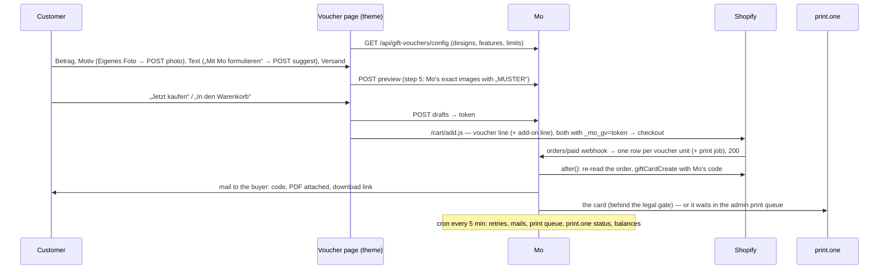

# Geschenkgutscheine — gift vouchers designed in the shop, issued as Shopify gift cards

Customers design a gift voucher on the shop page `/pages/gutschein` (theme section „Gutschein-Designer“)
in five steps — **1 Betrag → 2 Motiv → 3 Text → 4 Versand → 5 Prüfen & kaufen** — and pay in the normal
Shopify checkout. For every paid voucher Mo creates a **real Shopify gift card** with a code Mo generated,
renders the voucher (an A4 PDF), mails it to the buyer and, for the „Premium-Karte per Post“, has a folded
14 × 14 cm card printed and posted by print.one (or printed in-house). The admin screen **„Gutscheine“**
lists every voucher, issues vouchers by hand (Kulanz, Marketing, Gewinnspiel, Firmengeschenk, Sonstiges),
decides held ones, resends, deactivates („Sperren“) and runs the print queue. Not the newsletter
„Willkommensgutschein“ (a discount code, `CONSENT_REWARD_*`, [`WELCOME_VOUCHER_TODO.md`](./WELCOME_VOUCHER_TODO.md)).

This document owns the feature. Elsewhere, linked rather than repeated: the wire shapes of the storefront
routes — [`frontend/API_CONTRACT.md`](./frontend/API_CONTRACT.md) §3d; the screen in detail —
[`ADMIN_DASHBOARD.md`](./ADMIN_DASHBOARD.md) §3.13 (routes and audit keys §11); retention windows and the
erasure rules — [`DATA_RETENTION.md`](./DATA_RETENTION.md) „Geschenkgutscheine“; the legal questions —
[`ANWALTSDOSSIER.md`](./ANWALTSDOSSIER.md) § 23; default and purpose of every variable —
[`.env.example`](../.env.example) „Gift vouchers“; what is migrated, switched on and uploaded in production
— [`ROLLOUT_TODO.md`](./ROLLOUT_TODO.md) item 28 only.

## 1. A regular product, a Mo-issued gift card

- **The voucher is a regular Shopify product** (handle `designgutschein`, `GIFT_VOUCHER_PRODUCT_HANDLE`) with
  one variant per amount; the Premium-Karte is a separate add-on product (`gutschein-premiumkarte`,
  `GIFT_VOUCHER_PRINT_PRODUCT_HANDLE`). Mo recognises order lines by the **product ids** of these two handles
  (Admin API `productByIdentifier`, cached 10 minutes per instance). The private line property `_mo_gv`
  only links a line to the design the customer made; the amount always comes from the line's price, never
  from the design.
- **Why not Shopify's gift-card product:** Shopify never returns the full code of a card it issues itself
  (only the last four characters), so Mo could not print it — and such a product would issue (and mail) a
  second card of its own. If the voucher product is a gift-card product, Mo issues nothing (reported; the
  setup check shows an error). The shop's existing native product `motion-sports-geschenkgutschein` stays
  untouched; it is the page's fallback link.
- **The card.** One `giftCardCreate` per voucher unit (scope `write_gift_cards`) with the initial value, Mo's
  code, the expiry date and an internal note („Mo-Geschenkgutschein G-2026-00042 · Bestellung #1234“; by
  hand „… · Kulanz (von Hand)“). No customer and no recipient on the card, so Shopify
  sends no mail of its own. The card is valid in the checkout at once; a remaining balance stays on it.
- **The code:** 16 characters from 32 symbols without the look-alikes 0/O/1/I (80 bits), shown in groups of
  four („ABCD EFGH JKLM NPQR“). Mo stores it AES-256-GCM-encrypted with `TOKEN_ENC_KEY`
  (`token-crypto.ts`) **before** Shopify sees it, plus its sha256 (the balance lookup) and its last four
  characters (display, search). It never appears in a log, a URL, a KPI event, an audit row or the mail log.
- **The number** people see and search for: `G-<Berlin year of creation>-<id, five digits>`, e.g.
  `G-2026-00042` (derived, no column).
- **Validity:** until 31 December of the Berlin year of issuing plus `GIFT_VOUCHER_VALIDITY_YEARS` (default
  3 — the regular limitation period; 0 = never expires). The date is the card's expiry in Shopify and is
  printed on the voucher.
- **Not built (v1):** custom amounts („Wunschbetrag“), scheduled delivery to the recipient, wallet passes,
  KPI events from the page, bulk / CSV issuing, applying the code to the cart automatically.

## 2. The flows

### 2.1 Bought in the shop

The amounts and the add-on's price are the variants of the two products, rendered by Liquid — Mo serves
no prices. Mo's part, step by step: §4 (issuing), §5 (print), §7 (the storefront routes).

### 2.2 Issued by hand

Gutscheine → **„Gutschein ausstellen“**: Wert (1 € up to `GIFT_VOUCHER_ADMIN_MAX_EUR`, default 250 €),
Anlass (Kulanz, Marketing, Gewinnspiel, Firmengeschenk, Sonstiges), Motiv (every design except „Eigenes
Foto“), Für, Von (default „Dein motion sports Team“), Nachricht, Versand and an internal note. Versand:

- **PDF** — „PDF herunterladen“ in the admin; no mail.
- **E-Mail** — Mo mails the voucher to the given address (the recipient mail of §4.5).
- **Premium-Karte** — a print job (`queued`) with the given address.

A **Marketing** voucher is PDF only — Mo neither mails nor posts advertising without a consent. The voucher
is created leased to the request and issued at once; whether the card exists shows on its status (a failed
try is retried by the sweep). A voucher by hand is German, skips the order checks, the shop's price limits
and the daily limit, and works while the master switch is off.

### 2.3 Balance check

„Guthaben prüfen“ at the bottom of the page (anchor `#guthaben` — the QR code on every voucher points
there): `POST /api/gift-vouchers/balance` looks the code up by its sha256 only. Only vouchers Mo issued
(issued or deactivated) are found; the live balance comes from Shopify (≤ 4 s), else the stored one, and
the stored balance is updated. It works while the shop does not sell vouchers. Other gift cards (the old
native product) show their balance only in the checkout.

## 3. Statuses, holds and flags

One row per voucher **unit** (an order line with quantity 2 is two vouchers). Labels as the admin shows them
(`gift-voucher-core.mjs`).

| Status | Label | Meaning |
| --- | --- | --- |
| `pending` | Wartet | Recorded and due; the next issuing step takes it. |
| `held` | Zu prüfen | An operator decides — „Ausstellen“ or „Ablehnen“ (hold reasons below). |
| `issuing` | Wird ausgestellt | The code is stored, the Shopify card is being created — or its answer got lost; the next try adopts the card by its code. |
| `issued` | Ausgestellt | The Shopify card exists. |
| `failed` | Fehler | Shopify refused for good (`invalid`, above the issue limit), the order is gone, a card found by the code does not match, or an operator's try failed — „Erneut versuchen“ or „Ablehnen“. |
| `rejected` | Abgelehnt | An operator rejected it; a card an earlier try may have made is deactivated first. |
| `cancelled` | Storniert | The order was cancelled or refunded before a card existed. |
| `deactivated` | Gesperrt | The card is deactivated in Shopify (irreversible): „Sperren“, the revocation of an untouched card (§4.4), or found deactivated in Shopify by the balance sync („Abgleichen“ or the daily sync). |

**Hold reasons.** The first five are decided when the order is recorded (from the webhook payload — the row
starts `held`); the issuing step checks again with Shopify's current view of the order and adds the rest.

| Key | Label | When |
| --- | --- | --- |
| `disabled` | Gutscheine sind ausgeschaltet | `GIFT_VOUCHERS_ENABLED` is off. |
| `test_order` | Testbestellung | A Shopify test order and `GIFT_VOUCHER_ALLOW_TEST_ORDERS` is off. |
| `currency` | Fremdwährung | Not paid in EUR. |
| `discounted` | Rabatt auf den Gutschein angewendet | A discount reached the voucher line (allocations or the line's total discount). |
| `amount` | Betrag außerhalb der Grenzen | The unit price is outside `GIFT_VOUCHER_MIN_EUR` … `GIFT_VOUCHER_MAX_EUR`. |
| `risk` | Shopify meldet ein Betrugsrisiko | Shopify's risk level HIGH, or its recommendation CANCEL / INVESTIGATE. |
| `daily_limit` | Tageslimit erreicht | Shop vouchers issued today (Berlin) plus this one exceed `GIFT_VOUCHER_DAILY_LIMIT_EUR`. |
| `not_paid` | Nicht vollständig bezahlt | Not fully paid after 24 h, or refunded / voided before the card existed. |
| `attempts` | Zu viele Fehlversuche | The eleventh failed try — the one after the plan's last wait (§4.3). |

**Attention flags** — one column `attention`, „Achtung“ in the list; a revocation or a failed deactivation
is never overwritten by a print note. „Als geklärt markieren“ clears a flag.

| Key | Label | Meaning |
| --- | --- | --- |
| `cancelled_after_use` / `refund_after_use` | Storniert / Erstattet, aber schon (teilweise) eingelöst | The revocation intent of §4.4 — resolved within minutes for an untouched card; it stays when the card was (partly) spent. |
| `deactivate_failed` | Sperren in Shopify fehlgeschlagen | Shopify refused the deactivation. |
| `print_without_voucher` | Druck bezahlt, aber kein Gutschein in der Bestellung | A paid add-on line matched no voucher unit (flag on the order's first unit) — refund in Shopify. |
| `print_without_address` | Druck bezahlt, aber keine Adresse | The card was paid, the design had no address; the job waits „Zu prüfen“. |
| `print_cancel_too_late` | Druckauftrag ließ sich nicht mehr stornieren | The card was already in production when the voucher was revoked. |

**Mail status** (`mail_status`): `none` „Keine E-Mail“ (by hand, PDF or card), `pending` „Wartet auf
Versand“, `sent` „Gesendet“, `failed` „Fehlgeschlagen“, `skipped` „Keine Adresse“ (no usable address, or
revoked before the mail went out).

**Print job status:** `review` „Zu prüfen“ → `queued` „Wartet“ → `submitting` „Wird übermittelt“ →
`submitted` „Übermittelt“ → `printing` „Im Druck“ → `sent` „Versendet“; finals `failed` „Fehler“,
`cancelled` „Storniert“, `done` „Erledigt (manuell)“. Forward only (`canAdvancePrintJobStatus`): a late or
repeated update never moves a job back; `done` only from `review`, `queued` or `failed`.

## 4. Issuing

[`lib/gift-voucher-issue.ts`](../src/lib/gift-voucher-issue.ts); the decisions are pure and tested in
`gift-voucher-core.mjs` (one unit) and `gift-voucher-issue-core.mjs` (recording, order changes, retry
timing, adoption, fulfilment).

### 4.1 Recording — `orders/paid`

In the order branch of `/api/webhooks/shopify`, after the order ledger and the attribution and
**independent of `SHOPIFY_CUSTOMER_SYNC_ENABLED`**, `recordGiftVoucherOrder` runs synchronously — Shopify
counts an answer slower than 5 s as failed:

- **Products** by handle (cached; a cold lookup waits at most 2.5 s). Not resolvable while a line carries a
  valid `_mo_gv` → the delivery answers 500, is forgotten and Shopify redelivers. Not resolvable without
  such a line → the order is acknowledged unchecked (every order of the shop passes here). The voucher
  product missing while a line carries `_mo_gv` → 500 + report; a gift-card product → nothing recorded,
  reported.
- **One row per unit**, unique per (order, line item, unit) — a redelivery never adds a voucher. Amount =
  the line's shop-currency unit price (a unit without a price is skipped and reported). Design, texts and
  photo come from the draft of the line's token; without a known draft (bought from the product URL) the
  design `classic` without texts. Buyer e-mail (order, contact or customer e-mail), buyer name, the Shopify
  customer id and Mo's customer row when the customer is mirrored; the language from the order's
  `customer_locale` (`en…` → an English voucher and mail, else German); delivery `print` for a unit an
  add-on line with the same token pays for, else `pdf`. Mail `pending`, or `skipped` without an address.
- **Print jobs** for the `print` units: the effective provider (§5.2), the address copied from the draft,
  status `review` when the design has a customer photo and „Druck mit eigenem Foto prüfen“ is on or when the
  address is missing (+ `print_without_address`), else `queued`. Add-on lines that pay for no voucher flag
  the order's first unit (`print_without_voucher`).
- The drafts are stamped ordered; then the webhook's `after()` issues the order's units
  (`processGiftVoucherOrder`, 45-s budget).

### 4.2 One unit becomes a card

`issueOne` is the only place a card is created:

1. **Lease.** Every worker claims rows with `FOR UPDATE SKIP LOCKED` and a 3-minute lease (`locked_until`),
   so the webhook's `after()`, the cron sweep and an operator's click never work on the same voucher. A
   worker that dies leaves the row to the sweep once the lease ran out.
2. **The order (shop units).** Shopify's current view (one read per order and run): cancelled → revoke
   (§4.4); refunded, partly refunded or voided before the card exists → held `not_paid`; then the decision
   — master switch, test order, paid, currency, amount, fraud risk, daily limit. Units by hand skip this.
3. **The code** is generated and stored encrypted with status `issuing` **before** Shopify sees it; a
   stored code is never replaced. Without a usable `TOKEN_ENC_KEY` no code is generated (retry, then held).
4. **`giftCardCreate`.** A lost answer (transport error) or `TAKEN` → the card is looked up by its code and
   adopted when it is active and of exactly the voucher's value — never a second card; not found yet → retry.
   `denied` (scope `write_gift_cards` missing) or Shopify not configured → retry; `invalid` or above Shopify's
   issue limit → `failed`.
5. **`issued`** with the balance and a fresh download-token hash (the plain token lives only in memory, for
   the mail); then the mail (§4.5) and the print submission (§5). Their failures never undo the card — the
   sweep retries them.

### 4.3 Retries and deferrals

- **A failed try** is retried after 1, 2, 5, 15, 30, 60, 120, 240, 480, 720 minutes (ten retries); the eleventh
  failed try → held `attempts` (the error stays visible as „Letzter Fehler“).
- **Fraud check still PENDING** → looked at again every 5 minutes, no attempt counted; once
  `GIFT_VOUCHER_RISK_WAIT_MINUTES` (30) have passed since the unit was recorded it is issued anyway. HIGH,
  CANCEL and INVESTIGATE always hold.
- **Not fully paid** → every 30 minutes; held `not_paid` after 24 hours.
- **The operator overrides:** „Ausstellen“ (held) and „Erneut versuchen“ (failed) skip the automatic
  decision — only a cancelled or unpaid order still refuses. A try that fails then stays „Fehler“ for the
  next click, without automatic retries.

### 4.4 Revocation — cancellation and refund

`orders/cancelled` and `orders/updated` (refunds) run `handleGiftVoucherOrderChange`, again synchronous and
database-only: every unit of a cancelled order, else the refunded units of each voucher line (the highest
unit first).

- A unit that never became a card and has no code → `cancelled` at once (its unsent print job cancelled, a
  pending mail `skipped`). One with a stored code (an earlier try may have made the card) → back to
  `pending` with the revocation flag; the issuing step looks the card up by its code.
- An `issuing` or `issued` unit gets the flag `cancelled_after_use` / `refund_after_use` — the **durable
  intent**, written before the webhook answers. A refunded add-on line cancels that many print jobs.
- After the answer (`after()`), the issuing step and the sweep resolve the flag against Shopify, whoever
  comes first: an **untouched card** (balance = initial value) is deactivated (irreversible; reason
  „Bestellung storniert“ / „Erstattet“), the flag cleared and its card print cancelled at print.one when
  still possible; a card already deactivated in Shopify is recorded. **A (partly) spent card is never
  deactivated automatically** — the flag stays („… aber schon (teilweise) eingelöst“) and an operator
  decides with the customer whether to „Sperren“. Shopify refusing the deactivation → `deactivate_failed`.
- A revoked voucher's code is never mailed.

### 4.5 The voucher mail

[`lib/gift-voucher-mail.ts`](../src/lib/gift-voucher-mail.ts) over the tested
`gift-voucher-mail-core.mjs`:

- **Who gets it:** a shop voucher the buyer (who forwards or prints it); a voucher by hand with Versand
  „E-Mail“ the given recipient; by hand as PDF or card nobody.
- **Transactional** (the buyer paid for it): no marketing, no discount, no promo block, no unsubscribe link.
  Branded shell in the design of the mail kind `gift_voucher` — not a selectable kind, so the classic design;
  the standard sender, and replies land where every Mo mail's replies land (`INBOUND_EMAIL_ADDRESS`, Eingang).
- **Subject** „Dein Geschenkgutschein über 50,00 € ist da“ (recipient of a voucher by hand: „Ein
  Geschenkgutschein für dich“; English for `en`). The code is in the body only — never in the subject or the
  preheader.
- **Body:** thanks, Für / Von, Wert, Gültig bis, Gutschein-Nr., the order, the code, how to redeem, the PDF
  attached (`Gutschein-G-2026-00042.pdf`), the download button
  (`<PUBLIC_BASE_URL>/api/gift-vouchers/download?t=<token>`), for a card on its way „Die Premium-Karte wird
  gedruckt und an … geschickt — meist in 3–6 Werktagen“, links „Guthaben prüfen“ (`GIFT_VOUCHER_PAGE_URL`
  + `#guthaben`) and „Gutscheinbedingungen“ (`GIFT_VOUCHER_TERMS_URL`). The personal message is not repeated
  (it is on the voucher); every typed string is escaped.
- **Never twice:** the Resend idempotency key is `gift-voucher-mail-<id>-<mail_attempts>`. A repeat of the
  same try (a worker died after Resend took the mail) is refused by Resend (409) and recorded as sent.
- **Failures:** retried on the plan of §4.3, `failed` after the eleventh failed try; a mail Resend refuses as
  invalid (the address, the payload) → `failed` at once. A PDF that cannot be rendered is retried twice, then
  the mail goes without the attachment (code and link are the delivery).
- **The link rotates:** „E-Mail erneut senden“ and every retry create a new download token; an older link
  stops working (404). Only the token's sha256 is stored.
- **The mail log** (`email_messages`, the Korrespondenz — also read by the AI customer profile) gets a
  **redacted** copy: the code masked to its last four characters („•••• •••• •••• NPQR“), no download link.

### 4.6 The sweep — `/api/cron/gift-vouchers`

Every 5 minutes (`vercel.json`), `CRON_SECRET`, `maxDuration` 120 s with a 100-s budget; before migration
0083 it answers `{ ok: true, skipped: "migration_missing" }`. In this order, each step only while time
is left: due units (≤ 20 — issue, retries, revocations of units without a card) → revocation flags of
issued cards (≤ 10) → due mails (≤ 20) → print: submit (≤ 10), poll print.one (≤ 20), delete print files
of finished jobs (≤ 20 jobs) → balances not read for 24 h (≤ 15, live cards first) → fulfilment. Answer:
`{ ok, issued, held, deferred, failed, mailed, printSubmitted, printPolled, assetsCleaned, balancesSynced,
fulfilled }` (`assetsCleaned` counts files, two per job).

**Fulfilment** (`GIFT_VOUCHER_FULFILL_ORDERS`, default off; scope
`write_merchant_managed_fulfillment_orders`): a voucher line is marked fulfilled once every unit became a
card, an add-on line once its jobs are with the printer or done — without notifying the customer; at most
five orders per run; an order whose fulfilment fails for good is skipped for six hours on that instance.

### 4.7 Failure modes

| What happens | How it ends |
| --- | --- |
| The webhook is slow, or the products cannot be loaded while a line carries `_mo_gv` | 500 → Shopify redelivers; the insert is idempotent per order line unit, print jobs per voucher. |
| A worker dies anywhere | The 3-minute lease runs out, the sweep continues from the stored state; a stored code is reused. |
| Death after the code was stored or after the card was created | The next try gets `TAKEN`, finds the card by its code and adopts it — if it is active and of the voucher's value, else `failed`. |
| Shopify errors (transport, denied, not configured, order not readable) | Retry plan, held `attempts` after the eleventh failed try; `invalid` / above the issue limit → `failed`. |
| `TOKEN_ENC_KEY` missing | No code is generated (retry, then held); stored codes cannot be read (reveal, PDF, mail, print fail with „TOKEN_ENC_KEY prüfen“). |
| Resend refuses or times out | Mail retry plan with a new key per concluded try; a repeat of the same try is a 409 → recorded as sent. |
| Cancellation lands while the card is being created | The issuing step re-reads the row after `issued` and resolves the flag at once — the code is never mailed. |
| An admin „E-Mail erneut senden“ races a sweep mail | Can send twice (the same code) — the one known small window. |

## 5. The Premium-Karte

[`lib/gift-voucher-print.ts`](../src/lib/gift-voucher-print.ts), the print.one client
[`lib/printone.ts`](../src/lib/printone.ts), the pure parts `printone-core.mjs` and `printone-webhook.mjs`
(tested).

### 5.1 The card and its files

- A **folded 14 × 14 cm card** in an envelope — print.one's format `GREETINGCARD_SQ14`, finish
  `PRINTONE_FINISH` (`MATTE`, or `GLOSSY`). Front: the design; back: wordmark and „motionsports.de“ at the
  bottom, the central area empty — print.one prints the recipient's address in a Ø 77 mm circle there (Mo
  keeps Ø 95 mm free); inside: the message on the left, the code panel on the right. The customer pays the
  add-on product; Mo shows `PRINTONE_CARD_COST_CENTS` (380 = 3,19 € net + 19 % VAT) as the cost per card.
- **One print.one template, Mo's own images.** The template (`PRINTONE_TEMPLATE_ID`) has two pages holding
  nothing but a full-bleed `` / ``;
  `npm run verify:printone -- --create-template` creates it and prints its id. Mo renders both spreads itself
  (§6): JPEG 3378 × 1724 px including 3 mm bleed, 300 dpi, sRGB, folded in the middle — `outside` = back |
  front (front right with `PRINTONE_FRONT_SIDE=right`, mirrored with `left`), `inside` = message | code.
- **Hosted by Mo.** The spreads are rendered once per job, stored in the private Blob store
  (`gift-voucher-print/<token>-outside.jpg` / `-inside.jpg`) and served to print.one's renderer at
  `<PUBLIC_BASE_URL>/api/gift-vouchers/print-asset/<token>-<side>.jpg` — a 192-bit token per job, only while
  the job is `queued`, `submitting`, `submitted` or `printing`, `no-store` and `noindex`; anything else is a
  plain 404. The renderer loads them anonymously (any non-2xx fails the order), so `PUBLIC_BASE_URL` must be
  the public https address (`https://mo.motionsports.de`).

### 5.2 Providers and the legal gate

- **`GIFT_VOUCHER_PRINT_PROVIDER`** `printone` (default) or `manual` (the in-house print queue: download the
  print files, print, post, „Als versendet markieren“). The **effective** provider falls back to `manual`
  while `PRINTONE_API_KEY` / `PRINTONE_TEMPLATE_ID` are missing; a job keeps the provider it was created with.
- **print.one gets an address only when all of these hold:** `GIFT_VOUCHER_PRINT_SENDS_APPROVED` (the
  **legal gate**, default off, fail-closed — print.one is a new processor and needs its own AV-Vertrag /
  DPA first), print.one configured, provider `printone`, an https `PUBLIC_BASE_URL`; and for the job: status
  `queued`, voucher issued (not deactivated, cancelled or rejected), an address valid for
  `GIFT_VOUCHER_PRINT_COUNTRIES` (default `DE`). A blocked job stays `queued`: the job card names the block
  („Jetzt drucken“ is disabled with the reason); a job blocked by its own data carries the reason as its error
  and is looked at again hourly. Separate from `PHYSICAL_MAIL_SENDS_APPROVED` (Pingen letters).
- **The page offers the card only when it can be fulfilled:** `GIFT_VOUCHER_PRINT_PROVIDER=manual`, or print.one
  configured and the gate approved — never while the shop does not sell. The fallback above does not count: with
  the default `printone`, no print.one keys or a closed gate, the page sells no card.

### 5.3 Submission — one card, never two

1. **Ownership:** `queued` → `submitting` succeeds for exactly one caller; a job left `submitting` by a dead
   process is taken over by the sweep after 5 minutes.
2. **Files** are rendered once per job and recorded only after both uploads succeeded — the URLs, and with
   them the request body, stay the same for every attempt.
3. **`POST /v2/orders`** (one card per call, header `x-api-key`) with the `Idempotency-Key`
   `gift-voucher-print-<jobId>` (print.one keeps it 24 h) and a body built only from the job row
   (`recipient`, `mergeVariables`, `templateId`, `finish`, `billingId` = `PRINTONE_BILLING_ID`).
4. **Before any repeat** Mo searches print.one's newest orders (≤ 300) for its asset token and adopts the
   order it finds; when print.one cannot be asked (no answer, 5xx / 429, 401/403), nothing is posted — only a
   search print.one refuses outright (another 4xx) lets the POST go ahead, still guarded by its Idempotency-Key.

print.one refusing the request itself (an HTTP 4xx of kind `invalid`) or reporting `order_failed` fails the
job; every temporary problem — network, 5xx, 401/403, no prepaid balance, template not found, an
idempotency conflict — is retried on the plan of §4.3 and then every 12 hours: the outcome of an
unanswered attempt is unknown, and `failed` can only move on to `done`. A job blocked by its own data
(address, voucher not issued yet) is looked at again after an hour.

### 5.4 Status: webhook and polling

- **`POST /api/webhooks/printone`** — event `order_status_update`, header `x-webhook-hmac-sha256` =
  base64 HMAC-SHA256 of the raw body with `PRINTONE_WEBHOOK_SECRET`, checked before parsing in constant time;
  several secrets separated by commas are all accepted (rotation: add the new one, switch the portal, drop
  the old). 503 without a secret (statuses then come from polling only) or without a database, 413 above
  256 KB, 401 for a missing or wrong signature, 400 for a signed body that is not JSON, 200 for other events
  and orders that are not Mo's, 500 only when the store failed (print.one may deliver again).
- **Mapping:** `order_created` / `order_scheduled` → `submitted`, `order_pdf_queued` / `order_pdf_created` →
  `printing`, `order_pdf_delivered` → `sent`, `order_cancelled` → `cancelled`, `order_failed` → `failed` —
  monotonic and idempotent, because print.one signs no timestamp: a replayed or late event changes nothing.
- **Polling** is the safety net: the sweep re-reads jobs at print.one that have not changed for 60 minutes
  (180 minutes while the webhook secret is set).

### 5.5 What the operator does with a job

„Freigeben“ (`review` → `queued`; needs a valid address), „Jetzt drucken“ (submit now, confirmed with the
cost), „Stornieren“ (not at print.one yet → cancelled in Mo; at print.one → cancelled there first, too late
once in production), „Druckdateien herunterladen“ (manual jobs and failed print.one jobs: the two spreads
as JPEG — the stored files while they exist, else rendered anew) and „Als versendet markieren“ (`done`;
manual jobs and failed print.one jobs; refused while print.one has the order). A print.one job that waits
for the gate stays in the queue until the gate opens — the screen offers „Stornieren“ for it, not the
in-house actions. The sweep deletes the print files of finished jobs and of jobs
older than 14 days (never while submitting) and forgets their token — the asset URL then answers 404; a job
that is submitted later renders its files again.

### 5.6 `npm run verify:printone`

Read-only by default, never prints a secret: the env (`PRINTONE_*`, `GIFT_VOUCHER_PRINT_*`,
`PUBLIC_BASE_URL`, the gate), `GET /v2/countries` (every print country supported), the key mode
(`GET /v2/webhooks` answers only a LIVE key — and then the webhook for `order_status_update` must point at
`<PUBLIC_BASE_URL>/api/webhooks/printone`), the template (format `GREETINGCARD_SQ14`, exactly the two
variables, two pages). One option at a time:

- `--create-template` — creates the template, prints the id for `PRINTONE_TEMPLATE_ID`.
- `--test-order <outside-url> <inside-url> [--live]` — one order with the TEST key (`PRINTONE_TEST_API_KEY`,
  else `PRINTONE_API_KEY`) to the shop's own address, `billingId` „Mo Test“; TEST orders are never printed
  and cost nothing. A key that looks LIVE is refused unless `--live` (then a real proof card ≈ 3,80 € goes to
  the shop); a billable order made without `--live` is cancelled at once. Saves the preview PDF.
- `--preview <orderId>` — saves an order's preview PDF; `--test-pattern <dir>` — writes the two geometry
  test patterns (PNG 3378 × 1724, no network).

**Checking the geometry and `PRINTONE_FRONT_SIDE`** (before the first live card):

1. `npm run verify:printone -- --test-pattern ./tmp`.
2. Upload both PNGs somewhere public over https (Shopify admin → Inhalte → Dateien gives a cdn.shopify.com
   URL) — print.one's renderer must load them.
3. `npm run verify:printone -- --test-order <url-aussen> <url-innen>` (needs `PRINTONE_TEMPLATE_ID`; if
   print.one is still rendering, fetch the preview later with `--preview <orderId>`).
4. In the preview PDF (page 1 = outside, page 2 = inside): print.one prints the address circle on the
   **back** — on the half labelled LINKS → the front is right → `PRINTONE_FRONT_SIDE=right` (default); on
   RECHTS → `left`. The printed circle must lie inside the dashed Ø 77 mm circle and well inside the Ø 95 mm
   keep-out ring; nothing important outside the green safe line (5 mm); the page neither rotated nor
   mirrored; page 2: LINKS = message, RECHTS = code. If the circle sits off-centre, the back layout
   (`gift-voucher-designs.mjs`) must move its keep-out area.
5. The same with real voucher spreads, while the gate is still closed: issue a 1 € voucher by hand with
   Versand „Premium-Karte“ (a real card), take its two spreads — „Druckdateien herunterladen“ when its job is
   a manual one, else, signed in to the admin, `/api/admin/gutscheine/print-file?id=<voucher id>&side=outside`
   and `…&side=inside` —, upload them like the test patterns and place one more `--test-order`. Then
   „Sperren“ that voucher: its print job is cancelled with it, so opening the gate later never prints it.
   Last, one `--live` proof card to the shop to judge paper, colours and the envelope.

## 6. Rendering

[`lib/gift-voucher-render.ts`](../src/lib/gift-voucher-render.ts) (sharp, qrcode) over the pure SVG builders
of [`gift-voucher-designs.mjs`](../src/lib/gift-voucher-designs.mjs) (tested).

- **Six designs** („Motive“, keys fixed): `classic` „Klassisch“, `birthday` „Geburtstag“, `christmas`
  „Weihnachten“, `thanks` „Danke“, `training` „Training“, `photo` „Eigenes Foto“ (the customer's photo full
  bleed on the front; shop only). Each has a default line for an empty message („Viel Freude beim Training!“,
  „Alles Gute zum Geburtstag!“ …). Decorations are vector and seeded — the same input gives the same artwork
  at every resolution.
- **A photo voucher without its photo:** a preview shows `classic`, a delivered voucher never. When the stored
  photo cannot be read (Vercel Blob), there is no PDF and no print file — the download routes answer 503, the
  print job retries („Das Kundenfoto ließ sich nicht laden …“), the mail retries and then goes without the
  attachment. When it is read but cannot be decoded, the PDF is the plain text fallback without artwork (the
  download routes serve it, the mail attaches it at once) and there are no print files — the print job
  retries („Die Druckdateien konnten nicht erzeugt werden.“).
- **Every letter is a vector path** from the bundled fonts — no system font on Vercel. Texts are cleaned to
  what the fonts can draw (Basic Latin, Latin-1, Latin Extended-A without ſ, € „ “ ” ‚ ‘ ’ – — … • ‹ ›); emoji and
  other characters are removed, and the page tells the customer (`textRemoved`).
- **Fonts:** Montserrat 400/600/700/800 and Caveat 500/700 in `src/assets/fonts/`, under the SIL Open Font
  License 1.1 (`OFL-Montserrat.txt`, `OFL-Caveat.txt` beside them; taken from the `@expo-google-fonts`
  packages, not a dependency). They are read from disk at runtime, so `next.config.ts`
  (`outputFileTracingIncludes`) traces them into `/api/gift-vouchers/**`, `/api/admin/gutscheine/**`,
  `/api/cron/gift-vouchers` and `/api/webhooks/shopify` — **a new route that renders a voucher must be added
  there.** The page's live preview loads Caveat from `/api/gift-vouchers/fonts/caveat-500.ttf` (no Google
  Fonts in the shop).
- **The A4 PDF** (download and mail): one page — the landscape front (210 × 148.5 mm) on top, the inside
  below, a dashed cut/fold line between; one JPEG at 220 dpi (q 88) plus an invisible text layer with the
  code and the number, so both can be copied; title „Geschenkgutschein G-…“.
- **Previews:** JPEG; `landscape` = front and inside, `square` = front and the opened card (message | code,
  twice as wide). A sample carries a diagonal „MUSTER“ and the code „XXXX XXXX XXXX XXXX“.
- **Inside panel:** „Dein Gutscheincode“ in groups of four, Wert, Gültig bis (or „unbegrenzt gültig“), a QR
  code to `GIFT_VOUCHER_PAGE_URL#guthaben` (never the code), how to redeem, and the footer
  `GIFT_VOUCHER_ISSUER_LINE` · Gutschein-Nr. · „Bedingungen: <terms URL>“ (a long issuer line wraps at its own
  „ · “; message, „Von“ and „Für“ shrink or break onto a second line — nothing printed is cut off at the
  limits of the storefront). English vouchers (`en`) have English texts and dates („31 Dec 2029“).
- **Never throws:** a failed PDF becomes a plain text PDF with the same facts, code included (reported); a
  failed preview or print file is empty — the routes answer 503, the print pipeline retries. At most two
  renders at a time per instance; fonts are parsed once per instance.

## 7. Storefront API

Called by the voucher page from the theme setting „Backend URL“ (`https://mo.motionsports.de`). Shapes,
errors and the extra fields: [`frontend/API_CONTRACT.md`](./frontend/API_CONTRACT.md) §3d. Guard `secret` =
origin allowlist + `x-ms-chat-key`, `origin` = origin allowlist only.

| Route | Guard | Rate limit | Purpose |
| --- | --- | --- | --- |
| `GET /api/gift-vouchers/config` | origin | `products` | availability, designs with their backgrounds, features, limits, occasions and tones; cached 60 s |
| `GET /api/gift-vouchers/fonts/<file>` | origin | `products` | the Caveat font of the live preview (allowlist of two files), cached a year |
| `POST /api/gift-vouchers/photo` | secret | `gift-voucher` + `gift-voucher-ip` | „Eigenes Foto“: raw JPEG / PNG / WebP ≤ 4 MB, ≥ 500 px on the shorter side (under 1000 px the page warns that the Premium-Karte prints soft — config `limits.photoPrintMinSide`) → upright, sRGB, ≤ 2400 px, JPEG without metadata (EXIF, GPS dropped) → `photoId` |
| `POST /api/gift-vouchers/suggest` | secret | `gift-voucher-ai` + `gift-voucher-ip` | „Mit Mo formulieren“: 1–3 card texts with `{{fuer}}` / `{{von}}` |
| `POST /api/gift-vouchers/preview` | secret | `gift-voucher-render` + `gift-voucher-ip` | step 5: Mo's exact images with „MUSTER“ |
| `POST /api/gift-vouchers/drafts` | secret | `gift-voucher` + `gift-voucher-ip` | the design → `token` for the cart lines |
| `POST /api/gift-vouchers/balance` | secret | `gift-voucher-balance` (IP) | „Guthaben prüfen“ (§2.3) |
| `GET /api/gift-vouchers/download?t=` | none (mail link) | `gift-voucher-ip` | the PDF behind the mail's button; plain-text 404 for anything not issued |
| `GET /api/gift-vouchers/print-asset/<file>` | none (print.one) | none | the print spreads (§5.1) |

Buckets (`src/lib/rate-limit.ts`, Upstash): `gift-voucher` 40 / 10 min per session or IP, `gift-voucher-ip`
120 / 60 min per IP, `gift-voucher-ai` 12 / 10 min, `gift-voucher-balance` 10 / 10 min per IP (the guess
guard; 80-bit codes), `gift-voucher-render` 30 / 10 min. Without KV the routes answer 500 — rate limiting
never silently switches off. Availability: `GIFT_VOUCHERS_ENABLED` and „Verkauf im Shop“ (else
`disabled`), Shopify, the database and migration 0083 (else `not_configured`); while the shop does not
sell, the writing routes answer 409 and the page shows its fallback. Features: AI texts need
`ANTHROPIC_API_KEY` and „KI-Textvorschläge“, photos the Blob store and „Eigene Fotos“, the card §5.2.

**„Mit Mo formulieren“ sends no personal data to the model:** only the occasion (Geburtstag, Weihnachten,
Danke, Sport & Training, Einfach so), the tone (Herzlich, Witzig, Sportlich, Kurz & knapp) and the language.
The bulk tier (call site `gift_voucher_message`, [`AI_MODELS.md`](./AI_MODELS.md)) writes three texts with
the literal placeholders `{{fuer}}` (a greeting line) and `{{von}}`; the page fills in the names or drops an
empty greeting. Mo cleans the answer (placeholders, printable characters, ≤ 300 characters, ≤ 6 lines,
no signature line) and the page labels each text „KI-Vorschlag“.

## 8. The admin screen „Gutscheine“

Group Arbeit, no digit shortcut, icon `Gift`; in full: [`ADMIN_DASHBOARD.md`](./ADMIN_DASHBOARD.md) §3.13.
Stats (Verkauft (30 Tage), Ausgestellt gesamt, Offenes Guthaben, Eingelöst, Zu prüfen, Druckaufträge
offen, Entwürfe (30 Tage)); the list with search, status (incl. „Achtung“) and Quelle (Shop / Von Hand);
the detail with „Code anzeigen“ (audited), PDF, „E-Mail erneut senden“, „Ausstellen“ / „Ablehnen“,
„Erneut versuchen“, „Sperren“ (irreversible, with a reason), „Abgleichen“, the note and the print job;
„Gutschein ausstellen“ (§2.2); and **„Einrichtung“** (`#einrichtung`): the setup check (database and
migration, switches, which keys are set, the Shopify scope, both products with their findings — not found,
a gift-card product, taxable or shipping variants, several add-on variants —, Shopify's issue limit against
Mo's limits, print gate and provider, limits, validity) and the operator settings below.

**Settings** (`admin_settings` key `gift_vouchers`, no migration of their own; read with a 60-s cache per
instance; audit `settings.gift_vouchers`):

| Setting | Default | Effect |
| --- | --- | --- |
| Verkauf im Shop | an | The page sells (together with `GIFT_VOUCHERS_ENABLED`). |
| KI-Textvorschläge | an | „Mit Mo formulieren“ on the page. |
| Eigene Fotos | an | The design „Eigenes Foto“. |
| Druck mit eigenem Foto prüfen | an | A card with a customer photo waits in „Zu prüfen“ for „Freigeben“ before it is printed. |

## 9. Configuration

Every variable with its default and purpose is documented in [`.env.example`](../.env.example) „Gift
vouchers“; the readers are [`gift-voucher-flags.mjs`](../src/lib/gift-voucher-flags.mjs) (tested — truthy is
`1`/`true`/`yes`/`on`, an invalid value takes the default) and, for the three retention windows,
`retention-options.mjs`.

| Variable | Default | Purpose |
| --- | --- | --- |
| `GIFT_VOUCHERS_ENABLED` | `false` | **Master switch** — the page sells, paid orders are issued. Off: paid orders are recorded and held „Gutscheine sind ausgeschaltet“. |
| `GIFT_VOUCHER_PRODUCT_HANDLE` / `GIFT_VOUCHER_PRINT_PRODUCT_HANDLE` | `designgutschein` / `gutschein-premiumkarte` | The two products (regular products, not gift-card products). |
| `GIFT_VOUCHER_VALIDITY_YEARS` | `3` | Valid until 31.12. of the issuing year + n; `0` = never expires; at most 10. |
| `GIFT_VOUCHER_MIN_EUR` / `GIFT_VOUCHER_MAX_EUR` | `5` / `500` | Shop vouchers outside are held („Betrag außerhalb der Grenzen“). |
| `GIFT_VOUCHER_DAILY_LIMIT_EUR` | `2500` | Fraud brake: shop vouchers issued per Berlin day; beyond it they are held; `0` = no limit. |
| `GIFT_VOUCHER_ADMIN_MAX_EUR` | `250` | The highest voucher by hand. |
| `GIFT_VOUCHER_ALLOW_TEST_ORDERS` | `false` | Issue real, spendable cards for Shopify test orders — only while testing. |
| `GIFT_VOUCHER_RISK_WAIT_MINUTES` | `30` | Wait for a PENDING fraud check, then issue; `0` = no wait; at most 1440. |
| `GIFT_VOUCHER_PAGE_URL` | `https://www.motionsports.de/pages/gutschein` | QR target (+ `#guthaben`) and the mail's balance link; https only. |
| `GIFT_VOUCHER_TERMS_URL` | `https://www.motionsports.de/pages/gutscheinbedingungen` | The terms, printed and linked; https only. |
| `GIFT_VOUCHER_ISSUER_LINE` | `4motionsports GmbH · Am Weidegrund 1 · 82194 Gröbenzell` | The issuer printed on every voucher (≤ 160 characters). |
| `GIFT_VOUCHER_PRINT_SENDS_APPROVED` | `false` | **Legal gate** — addresses may go to print.one (§5.2); fail-closed. |
| `GIFT_VOUCHER_PRINT_PROVIDER` | `printone` | `printone` or `manual` (§5.2). |
| `GIFT_VOUCHER_PRINT_COUNTRIES` | `DE` | ISO-2 list the card may be posted to. |
| `GIFT_VOUCHER_FULFILL_ORDERS` | `false` | Mark voucher and add-on lines fulfilled in Shopify (§4.6). |
| `GIFT_VOUCHER_DRAFT_RETENTION_DAYS` / `GIFT_VOUCHER_ADDRESS_RETENTION_DAYS` / `GIFT_VOUCHER_PERSONAL_RETENTION_DAYS` | `30` / `180` / `365` | Retention (§11, [`DATA_RETENTION.md`](./DATA_RETENTION.md)); `0` disables a step. |
| `PRINTONE_API_KEY` | — | print.one key (a TEST key prints nothing); secret. |
| `PRINTONE_TEMPLATE_ID` | — | The `GREETINGCARD_SQ14` template (§5.1). |
| `PRINTONE_WEBHOOK_SECRET` | — | Webhook HMAC secret(s), comma-separated for rotation; without it the webhook answers 503. |
| `PRINTONE_TEST_API_KEY` | — | Only `verify:printone --test-order` (falls back to `PRINTONE_API_KEY`). |
| `PRINTONE_FINISH` | `MATTE` | `MATTE` or `GLOSSY`. |
| `PRINTONE_BILLING_ID` | `Gutscheine` | Cost centre on print.one's invoice. |
| `PRINTONE_CARD_COST_CENTS` | `380` | Cost estimate per card shown in the admin (3,19 € net + 19 % VAT). |
| `PRINTONE_FRONT_SIDE` | `right` | Which half of the outside spread is the front — check it (§5.6). |
| `PRINTONE_API_BASE` | `https://api.print.one` | Only for a local test server. |

Reused, nothing new to set: `TOKEN_ENC_KEY` (code encryption — **never rotate it**: stored codes would
become unreadable), `BLOB_READ_WRITE_TOKEN` (photos, print files), `RESEND_API_KEY` + `CONTACT_FROM_EMAIL`
(the mail), `PUBLIC_BASE_URL` (download links, print files — https), `ANTHROPIC_API_KEY` (text suggestions),
`CHAT_SHARED_SECRET` + `ALLOWED_ORIGINS` (the storefront routes), `KV_REST_API_*` (rate limits),
`CRON_SECRET` (the sweep).

**What an operator must set** — for selling: `GIFT_VOUCHERS_ENABLED=true` (last, §13); for print.one in
addition `PRINTONE_API_KEY`, `PRINTONE_TEMPLATE_ID`, `PRINTONE_WEBHOOK_SECRET`, `PRINTONE_FRONT_SIDE` as
measured, and `GIFT_VOUCHER_PRINT_SENDS_APPROVED=true` once the lawyer approved print.one as a processor
(the DPA, dossier § 23 F-48); for the card printed in-house instead `GIFT_VOUCHER_PRINT_PROVIDER=manual` —
without one of the two the page sells no card (§5.2). `PUBLIC_BASE_URL` must be the public https address.
Everything else has a working default.

## 10. Data model — migration `0083_gift_vouchers.sql`

Three tables, all data (wiped by `npm run db:reset`); the settings live in `admin_settings`
([`DATABASE.md`](./DATABASE.md) table index).

- **`gift_voucher_drafts`** — what a customer designed before paying, anonymous (no customer, e-mail or
  session; the cart lines carry only the opaque `token`): `token` (unique), `design_key`, `amount_cents`
  (preview only), `recipient_name`, `sender_name`, `message`, `photo_pathname`, `delivery` (`pdf` |
  `print`), `recipient_postal_address` (jsonb, the snake_case shape of `customers.postal_address`:
  `name`, `address_line_1`, `address_line_2`, `postal_code`, `city`, `country`), `locale`, `ordered_at`.
- **`gift_vouchers`** — one row per voucher unit: `source` (`shop` | `admin`), `reason` (`verkauf`,
  `kulanz`, `marketing`, `gewinnspiel`, `firmengeschenk`, `sonstiges`), `status`, `hold_reason`,
  `attention`, `amount_cents` (> 0), `currency`, `expires_on`, `code_enc` (bytea), `code_hash` (unique),
  `code_last4`, `shopify_gift_card_id` (unique), `shopify_order_id` / `_order_name` / `_line_item_id`,
  `unit_index` (unique per order line), `shopify_customer_id`, `customer_id` (FK customers, SET NULL),
  `buyer_email`, `buyer_name`, `draft_id` (FK drafts, SET NULL), `design_key`, `recipient_name`,
  `sender_name`, `message`, `photo_pathname`, `delivery` (`pdf` | `print` | `email`), `recipient_email`
  (by hand, „E-Mail“), `locale`, `download_token_hash` (unique), `mail_status` / `mail_attempts` /
  `mail_next_attempt_at` / `mailed_at`, `balance_cents` / `balance_checked_at`, `issued_at`,
  `deactivated_at` / `deactivation_reason`, `fulfilled_at`, `created_by`, `admin_note`, `attempts` /
  `next_attempt_at` / `locked_until` / `last_error` (the retry sweep and its lease),
  `personal_data_purged_at`.
- **`gift_voucher_print_jobs`** — the Premium-Karte of a voucher (at most one, cascade with it): `provider`
  (`printone` | `manual`), `status`, `recipient_postal_address`, `provider_order_id` (unique when set),
  `provider_status`, `asset_token` (unique) + the two pathnames, `cost_cents`, `paid_line_item_id` (the
  add-on line), `error`, `attempts` / `next_attempt_at` / `locked_until`, `submitted_at`, `sent_at`.

Run the migration **before** deploying the code that reads it (`npm run db:migrate`, by the maintainer).
Until it ran: the storefront reports `not_configured`, every admin route that reads vouchers answers 503
„Migration 0083 fehlt — bitte zuerst ausführen.“ (`gutscheine/settings` and `gutscheine/setup` work without
it), the sweep and the retention step do nothing, erasure and merge leave the tables out — and an
`orders/paid` delivery with a voucher line fails (500) until it ran, so Shopify keeps redelivering it: run
the migration before the products are on sale.

## 11. Privacy and security

- **What is stored:** the design (texts, photo, the card's address) — first anonymously as a draft, then
  copied into the voucher; the buyer (e-mail, name, Shopify customer id, Mo's customer row); for a voucher by
  hand the recipient's e-mail; the encrypted code with its hash and last four; balances; the print job with
  the recipient's address. Customer photos lie in the **private** Blob store (`gift-voucher-photos/`, EXIF
  stripped), print files under `gift-voucher-print/` only while needed.
- **Retention:** the three windows of §9 (`0` disables a step), enforced by step 5j of `/api/cron/retention` —
  drafts, the address of finished print jobs, and a voucher's personal data once it ended; amounts, status, the
  encrypted code with its hash / last four and ids stay. What each step deletes, and the known gap of „used
  up“ (the daily balance sync keeps that clause from ever firing): [`DATA_RETENTION.md`](./DATA_RETENTION.md)
  „Geschenkgutscheine“.
- **Erasure** (`erasePerson`) keeps the voucher — the card is money for its recipient — and removes the buyer;
  texts and photo leave with the retention, drafts are anonymous; a merge repoints `gift_vouchers.customer_id`.
  The rules: [`DATA_RETENTION.md`](./DATA_RETENTION.md) „Geschenkgutscheine“.
- **Codes and tokens are bearer value:** never logged, never in `reportError` contexts, KPI events, audit
  details or URLs (except the mail's download token and the print files' asset token); the mail log keeps a
  redacted copy (§4.5); revealing a code in the admin is audited (`gift_voucher.code_reveal`). The balance
  check finds a code only by its hash; a download token is stored only as its sha256, a print-asset token is
  a random 192-bit value that dies with the job's files.
- **Processors:** Shopify (the cards), Resend (the mail), Vercel Blob (photos, print files), Anthropic (text
  suggestions — occasion and tone only, no personal data), **print.one** (new — Print.one B.V., Netherlands,
  printed there and posted through PostNL: recipient name and address plus the card's artwork, which carries
  the code and the texts — only behind `GIFT_VOUCHER_PRINT_SENDS_APPROVED`). Legal questions:
  [`ANWALTSDOSSIER.md`](./ANWALTSDOSSIER.md) § 23.

## 12. The theme side

In the theme repo `ms_shopify_clone` (the upload list, the after-upload steps and the live checks are its
`MANIFEST.md` entry „Geschenkgutscheine: Gutschein-Designer“ of 2026-11-20):

- `sections/ms-gift-voucher.liquid` (schema „Gutschein-Designer“: product pickers „Gutschein-Produkt
  (Beträge)“ and „Premium-Karte (Zusatzprodukt)“, terms URL, fallback link, hero, „So funktioniert's“, FAQ,
  „Guthaben prüfen“), `assets/ms-gift-voucher.js`, `assets/ms-gift-voucher.css` (prefix `.ms-gv`),
  `templates/page.gutschein-mo.json` (uploaded **once** — afterwards it holds the theme editor's settings).
- The page **`/pages/gutschein`** (template `page.gutschein-mo`) — the QR codes and Mo's mails point to it —
  and the page **`/pages/gutscheinbedingungen`** with the terms.
- Config to the script only via data attributes: the backend URL and shared secret of the AI Advisor
  settings, the locale, the two products' variants from Liquid. The design state stays in the tab's
  sessionStorage (`ms-gv-draft`); names, messages and addresses never go into a URL.
- **Cart lines:** the voucher variant with the visible properties „Gutschein für“, „Motiv“, „Versand“ and
  the private `_mo_gv=<token>`; for the card the add-on variant with „Für Gutschein an“ and `_mo_gv`.
- Fallback (AI Advisor off, Mo unreachable, `available: false`, no amount, a gift-card product picked): a
  note with a link to the old gift card product.

## 13. Go-live checklist

Status of each step: [`ROLLOUT_TODO.md`](./ROLLOUT_TODO.md) item 28.

1. **Shopify products** (before the theme upload, so the template's handles resolve):
   - „Geschenkgutschein“, handle `designgutschein` — a **regular product, not a gift card product**; option
     „Betrag“ with one variant per amount (price = face value, e.g. 25 / 50 / 75 / 100 / 150 / 200 / 250 €,
     inside `GIFT_VOUCHER_MIN_EUR` … `_MAX_EUR`); **no tax charged** (a multi-purpose voucher is taxed when
     redeemed — confirm with the tax advisor); not a physical product (no shipping); inventory not tracked;
     product type `Gutschein`; sales channel Onlineshop on (the cart needs it), status unlisted („Nicht
     gelistet“ — only the voucher page shows it).
   - „Gutschein Premium-Karte“, handle `gutschein-premiumkarte` — one variant (e.g. 4,90 €), taxable, not a
     physical product (print.one posts it; the page collects the address), inventory not tracked, type
     `Gutschein`, Onlineshop on, unlisted.
   - **Excluded from every discount:** a smart collection „Alle Produkte ohne Gutscheine“ („Produkttyp ist
     nicht gleich Gutschein“) and every active code and automatic discount set to „Gilt für: bestimmte
     Kollektionen“ → that collection. Otherwise a voucher can be bought below its value (Mo would hold it as
     `discounted`).
2. **App scope `write_gift_cards`** (optional: `write_merchant_managed_fulfillment_orders` for
   `GIFT_VOUCHER_FULFILL_ORDERS`). Client-credentials tokens carry only the
   scopes granted at install, so the app must be re-authorised: add the scope to `[access_scopes]` in
   `shopify.app.toml`, `shopify app deploy`, then accept the updated permissions in the Shopify admin (or
   reinstall the app) — the procedure of [`ROLLOUT_TODO.md`](./ROLLOUT_TODO.md) item 16.3 (steps 1 and 3–6:
   `shopify app config link` first, so the file holds the active configuration). Then
   `npm run shopify:webhooks -- --url https://mo.motionsports.de` (read-only; it now lists `write_gift_cards`
   among the required scopes; `orders/paid`, `orders/updated` and `orders/cancelled` are already subscribed —
   `--apply` only if a reinstall removed subscriptions) and `npm run verify:gift-vouchers` (read-only: env,
   token, scopes, both products with their flags, the gift card configuration; `-- --create-test-card`
   issues a 1,00 € card and deactivates it at once).
3. **Migration 0083** — `npm run db:migrate`, run by the maintainer **before** the deploy (§10).
4. **Vercel env** (Production) as in §9; `PUBLIC_BASE_URL` = `https://mo.motionsports.de`. Deploy `main`;
   Settings → Cron Jobs lists `/api/cron/gift-vouchers` every 5 minutes.
5. **print.one** (only for the Premium-Karte via print.one; to print the cards in-house instead, set
   `GIFT_VOUCHER_PRINT_PROVIDER=manual` and skip this step — with neither the page sells no card, §5.2):
   account, a LIVE and a TEST API key (`PRINTONE_API_KEY`, `PRINTONE_TEST_API_KEY` locally), the **DPA
   (AV-Vertrag)** — print.one's processing agreement is part of its terms; the lawyer checks it first
   ([`ANWALTSDOSSIER.md`](./ANWALTSDOSSIER.md) § 23, F-48) —, a **prepaid balance** (a LIVE order without
   credit is refused and retried); `npm run verify:printone -- --create-template` →
   `PRINTONE_TEMPLATE_ID`; the webhook in the portal (Integrate → Webhooks, event `order_status_update`) to
   `https://mo.motionsports.de/api/webhooks/printone` → its secret as `PRINTONE_WEBHOOK_SECRET`; the
   geometry check of §5.6 → `PRINTONE_FRONT_SIDE`; then `GIFT_VOUCHER_PRINT_SENDS_APPROVED=true`.
6. **Theme:** upload the four files of the MANIFEST entry; the pages **„Gutschein“** (handle `gutschein`,
   template `page.gutschein-mo`) and **„Gutscheinbedingungen“** (handle `gutscheinbedingungen`, the terms —
   validity, redemption, remaining balance, no cash payout, Widerruf, loss; the lawyer reads them and the
   FAQ — dossier § 23, F-50; every voucher prints the link, so the page must exist before the first sale);
   in the theme editor both products in the section; Inhalte → Menüs → `mega-menu-26`: the item
   „Geschenkgutschein“ (today `/products/motion-sports-geschenkgutschein`) repointed to `/pages/gutschein`;
   Theme settings → Custom CSS: the selector `.side-menu-item[href="/products/motion-sports-geschenkgutschein"]`
   changed to `.side-menu-item[href="/pages/gutschein"]` (else the mobile menu loses the item's separator); the
   AI Advisor stays on with its shared secret (the page reads both).
7. **Admin check:** Gutscheine → „Einrichtung“ — every row ✓ (scope, both products without findings,
   `TOKEN_ENC_KEY`, Resend, Blob); Einstellungen → Systemstatus: „Druckpartner (print.one)“,
   „Gutschein-Kartendruck“, „Geschenkgutscheine“.
8. **Test order:** `GIFT_VOUCHER_ALLOW_TEST_ORDERS=true` (redeploy), Shopify payments in test mode or the
   Bogus Gateway, `GIFT_VOUCHERS_ENABLED=true`; buy a 25 € voucher as PDF (and, once the page offers the card
   — §5.2 — one with the Premium-Karte): the mail with the PDF arrives (at the latest after
   `GIFT_VOUCHER_RISK_WAIT_MINUTES` while Shopify's fraud check is pending), Gutscheine lists it as
   „Ausgestellt“, the code works in the checkout, „Guthaben prüfen“ shows 25,00 €, the print job appears — a
   job „Von Hand“ in the queue with `GIFT_VOUCHER_PRINT_PROVIDER=manual`; with print.one, the gate open and a
   LIVE key print.one really prints and posts it to the address entered. Then „Sperren“ the test vouchers and
   set `GIFT_VOUCHER_ALLOW_TEST_ORDERS=false` again.
9. **Switch-on:** `GIFT_VOUCHERS_ENABLED=true` stays on; „Verkauf im Shop“ on. Orders paid while the switch
   was off wait in „Zu prüfen“ — „Ausstellen“ or „Ablehnen“ each.

## 14. Troubleshooting — where to look

| Symptom | Where | What to do |
| --- | --- | --- |
| The page shows the fallback | `GET /api/gift-vouchers/config` → `unavailableReason` | `disabled`: `GIFT_VOUCHERS_ENABLED` or „Verkauf im Shop“; `not_configured`: Shopify, database or migration 0083. AI / photo / card missing: the `features` and §7. |
| A paid voucher is not in the list | Shopify → the order's webhook deliveries; Vercel logs of `/api/webhooks/shopify` | A 500 is redelivered by Shopify. A voucher bought **without** the designer (no `_mo_gv`) is recognised only when the product lookup answers within 2.5 s — otherwise it is acknowledged unchecked and no voucher exists: issue one by hand. A gift-card product as voucher product: Einrichtung shows it. |
| „Zu prüfen“ | the detail's callout (reason + hint) | „Ausstellen“ or „Ablehnen“ (§3). |
| „Fehler“, or „Zu prüfen“ with „Zu viele Fehlversuche“ | „Letzter Fehler“ in the detail | „Shopify-Berechtigung write_gift_cards fehlt“ → the scope (§13.2); „TOKEN_ENC_KEY …“ → the key; above Shopify's issue limit or a card with another value under the code → check in Shopify (Einrichtung shows the limit). Then „Erneut versuchen“ / „Ausstellen“ — or „Ablehnen“. |
| Stuck „Wird ausgestellt“ / „Wartet“ | `next_attempt_at` / „Letzter Fehler“ | The sweep retries by the plan; cron runs in Vercel → Cron Jobs (401 = `CRON_SECRET`). |
| The mail did not arrive | the detail's row „E-Mail“ (status, tries); Resend → Emails (tag `kind=gift_voucher`) | „E-Mail erneut senden“ (a new link; a failure names Resend's error). „Keine Adresse“: the order had none — PDF from the admin. |
| „Achtung“ | the detail's callout | §3 attention flags; „Als geklärt markieren“ once handled. |
| A card print waits | the job card: status and error; „Jetzt drucken“ names the block | print.one job: gate, print.one configuration, https `PUBLIC_BASE_URL`, address („Freigeben“ for `review`); „Das Kundenfoto ließ sich nicht laden“ = Vercel Blob (the job retries by itself, never without the photo). Manual job: „Druckdateien herunterladen“, print, „Als versendet markieren“. |
| A print job „Fehler“ | the job's error (print.one's refusal) | A failed job is final: print it in-house („Druckdateien herunterladen“, „Als versendet markieren“) or refund the add-on line in Shopify (the voucher itself stays valid). |
| print.one statuses do not move | Vercel logs of `/api/webhooks/printone` (401 = secret, 503 = none set) | Polling still moves them (jobs unchanged for 60 min, 180 min while a webhook secret is set). |
| Everything else | Sentry / `reportError` with `route` `lib/gift-voucher-*`, `lib/printone`, `lib/shopify-gift-cards` and a phase — ids only, never a code, name or address | `npm run verify:gift-vouchers`, `npm run verify:printone`. |

## 15. Files

| Part | Files |
| --- | --- |
| Rules (pure, tested) | `src/lib/gift-voucher-core.mjs`, `gift-voucher-flags.mjs`, `gift-voucher-settings.mjs`, `gift-voucher-issue-core.mjs`, `gift-voucher-mail-core.mjs`, `gift-voucher-storefront.mjs`, `gift-voucher-designs.mjs`, `shopify-gift-cards-core.mjs`, `printone-core.mjs`, `printone-webhook.mjs`, `pdf-core.mjs` (`assembleImagePdf`), `src/app/admin/gutscheine/gutscheine-core.mjs` |
| Data | `migrations/0083_gift_vouchers.sql`, `src/lib/gift-voucher-store.ts`, `gift-voucher-blob.ts` |
| Issuing, mail | `src/lib/gift-voucher-issue.ts`, `gift-voucher-mail.ts`, `shopify-gift-cards.ts`, `email.ts` (attachments, idempotency key) |
| Rendering | `src/lib/gift-voucher-render.ts`, `src/assets/fonts/`, `next.config.ts` |
| Print | `src/lib/gift-voucher-print.ts`, `printone.ts` |
| Storefront | `src/app/api/gift-vouchers/*`, `src/lib/gift-voucher-storefront-io.ts`, `gift-voucher-message.ts`, `gift-voucher-photo.ts`, `rate-limit.ts` |
| Webhooks, cron | `src/app/api/webhooks/shopify/route.ts` (`giftVoucherOrderStep`), `src/app/api/webhooks/printone/route.ts`, `src/app/api/cron/gift-vouchers/route.ts`, `vercel.json` |
| Admin | `src/app/admin/GutscheineTab.tsx`, `src/app/admin/gutscheine/*`, `src/app/api/admin/gutscheine/*`, `src/lib/admin-tabs.mjs`; wired in `src/app/admin/page.tsx`, `lazy.tsx`, `tabs.tsx` (icon), `AdminShell.tsx` (shortcut sheet) |
| Elsewhere | `src/lib/token-crypto.ts` (the code's encryption), `src/app/admin/einstellungen/SystemStatusCard.tsx` + `EinstellungenTab.tsx` (Systemstatus rows), `business-snapshot.ts` / `-core.mjs` (switches), `ai-call-sites.mjs` + `ai-usage-store.ts` (call site `gift_voucher_message`), `scripts/register-shopify-webhooks.mjs` (scope `write_gift_cards`) |
| Privacy | `customer-erasure.ts` / `-core.mjs`, `customer-fk-plan.mjs`, `customer-merge-store.ts`, `retention.ts` (step 5j), `retention-options.mjs` |
| Catalog | `catalog-mapping.ts`, `scripts/convert-catalog.mjs` — both voucher products stay out of Mo's chat catalog |
| Scripts | `scripts/verify-gift-vouchers.mjs` (`npm run verify:gift-vouchers`), `scripts/verify-printone.mjs` (`npm run verify:printone`) |
